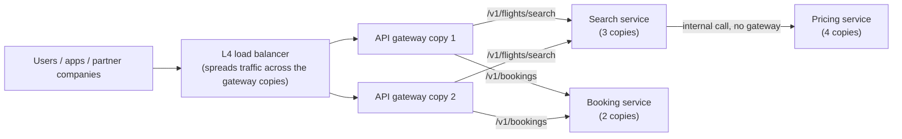
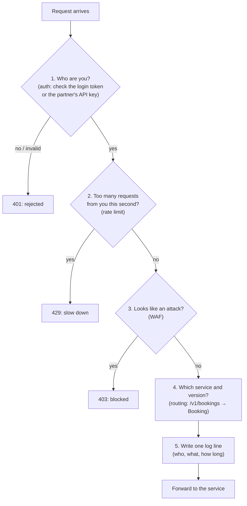
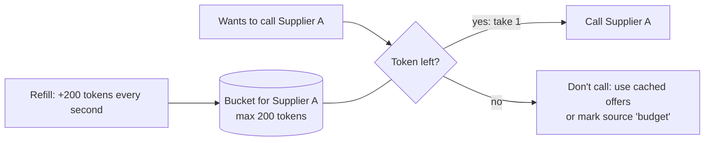
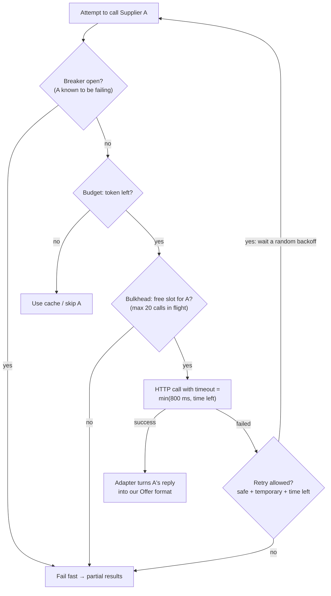
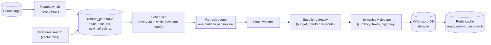
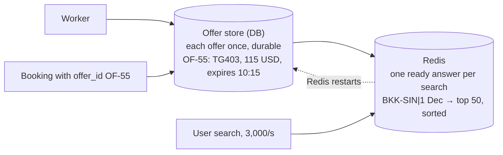

# Gateways, load balancers and the supplier pipeline (pictures)

> Companion to [05-Scenarios.md](05-Scenarios.md) S1's improved design. Plain words, one diagram per idea.

---

## 1. Load balancer vs API gateway

**Load balancer (LB)** = a traffic policeman for **copies of ONE service**. Three search servers? It spreads requests across them and stops sending to a dead one.

**API gateway** = the **reception desk of the whole building**. Every outside request passes it once. It checks who you are, how often you've come, whether you look dangerous, and **which department (service)** you need.



### What the reception desk (gateway) does, in plain words

| Word | Plain meaning |
|---|---|
| **API key for partners** | A long secret string we give to **another company** that calls our API (e.g. a travel site showing our hotel prices). It identifies *which company* is calling, so we can rate-limit, bill or block that company. It's a password for a program. |
| **WAF** (Web Application Firewall) | A filter that blocks requests matching **known attack patterns**: `' OR '1'='1` in a parameter, huge request bodies, known bad bots and IPs. |
| **Request logging** | One line per request: who called, which endpoint, status, time taken. Used for debugging, audits, billing partners. |
| **Versioning** | Old apps still call `/v1/...` while new apps call `/v2/...`; the gateway sends each to the right code. |

### Do we still need a load balancer if we have a gateway?
- **The gateway itself load-balances** to the services behind it (most gateways have this built in). So between the gateway and the services you often don't need a separate LB.
- **But the gateway runs as several copies**, so *something* must spread traffic across **them**. That's the **L4 LB** at the very front.
- **Internal calls** (search → pricing) don't go through the public gateway. They use an **internal LB**: in Kubernetes that's a `Service`, or a service mesh.

### When L4, when L7? (production cases)
| Use **L4** (looks only at IP + port) | Use **L7** (reads the HTTP request) |
|---|---|
| The **very front door**: millions of connections, cheapest, fastest, gives one fixed IP | **Routing by path or host**: `/search` → Search, `/book` → Booking |
| **Non-HTTP traffic**: databases, Kafka, Redis, game servers | **gRPC / HTTP/2**: must balance **per request**, not per connection |
| Pass encrypted traffic through untouched | Retries, sticky sessions by cookie, canary (send 5% to the new version) |

🔑 *LB = ek service ki copies mein baanto. Gateway = building ka reception: pehchaan, ginti, suraksha, sahi department.* (An LB spreads load across copies of one service. A gateway is the building's reception: identity, counting, security, the right department.)

---

## 2. The supplier gateway: one pipeline for every supplier call

It's **our** service (not the supplier's). Every call **we** make **to** a supplier goes through it, so timeouts, retries and breakers are written once, configured per supplier.

### Budget = a call allowance (token bucket)
Each supplier call costs money, and the supplier's contract allows at most, say, **200 calls/second**. The budget is a **bucket of 200 tokens** that refills **200 tokens every second**. Every call takes one token. **No token → don't call**: serve the cached offers or skip this supplier for now.


**Why "shared in Redis":** we run 20 copies of the gateway. If each copy had its own 200-token bucket, together they'd make 4,000 calls/s. So the **one** bucket for Supplier A lives in Redis, and every copy takes tokens from it.

### The order of the checks (each attempt, including retries)
**Principle: cheapest "no" first, and every retry goes through every gate again.**


- **Breaker first**: if A is known to be down, don't even spend a token or a slot.
- **Budget before the slot**: no money, no point waiting for a slot.
- **Bulkhead right before the call**: it limits how many calls to A can be *stuck at once*.
- **Timeout on the call itself**: each attempt gets its own time, cut to what's left of the user's deadline.
- **Retry loops back to the top**: a retry is a new call, so it must pass the breaker, spend a token and take a slot again.

*(Libraries differ in the exact nesting; this order is the reasoning to say aloud.)*

🔑 *Breaker khula? → Paisa hai? → Jagah hai? → Ghadi chalu → call. Fail hua toh: safe + temporary + time ho toh, upar se dobara.* (Is the breaker open? → Do we have budget? → Is there a slot? → Start the clock → call. If it fails: if safe, temporary and there's time, start again from the top.)

### "Key from the secret store"
Supplier A gives **us** a secret API key, so A knows **it's us** calling (and bills us). It's our password with them. It must **never be in code** (that was a CR-1 bug). It lives in a **secret store** (Vault, AWS Secrets Manager), the gateway loads it at startup, and it can be rotated without a code change.

### How companies build it
Libraries plus a per-supplier config file, not hand-written loops:
```yaml
suppliers:
  A: { timeout_ms: 800,  retries: 2, bulkhead: 20, breaker_fail_rate: 50, budget_per_s: 200 }
  B: { timeout_ms: 1500, retries: 1, bulkhead: 10, breaker_fail_rate: 50, budget_per_s: 50 }
```
Java: Resilience4j (Retry, CircuitBreaker, RateLimiter, Bulkhead, TimeLimiter wrappers). Go: gobreaker + `x/time/rate` + `context`. Adding a supplier = a new adapter + one config block.

---

## 3. The refresh pipeline (who decides what to refresh, and when)


| refresh_plan row | tier | interval | why |
|---|---|---|---|
| BKK-SIN, 1 Dec | HOT | every 5 min | 4,000 searches/hour |
| BKK-SIN, 15 Jan | WARM | every 1 h | 200 searches/hour |
| DEL-HKT, 3 Mar | COLD | only on a cache miss | 2 searches/day |

- **The popularity job fills the plan** from search logs; the **scheduler** picks due rows (`next_refresh_at <= now`), puts jobs on the queue, and sets the next time.
- **One queue partition per supplier**: if A slows us down, only A's jobs wait.

## 4. Why the offer store (DB) and then Redis

1. **Booking needs the offer to survive** until `expires_at`, even if Redis evicts it.
2. **If Redis restarts**, rebuild it from the DB instead of paying every supplier again.
3. **Different shapes**: the DB stores each offer once; Redis stores one ready answer per search, so a search is one lookup.
4. **Analytics**: price history, the price-changed-at-booking rate, and cost per route.

🔑 *DB = yaaddasht (durable), Redis = zubaan pe (fast).* (The DB is memory, durable; Redis is on the tip of the tongue, fast.)
