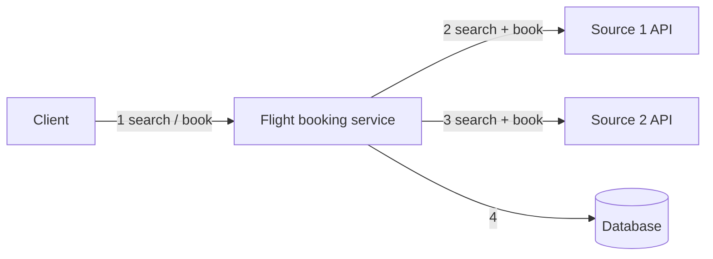
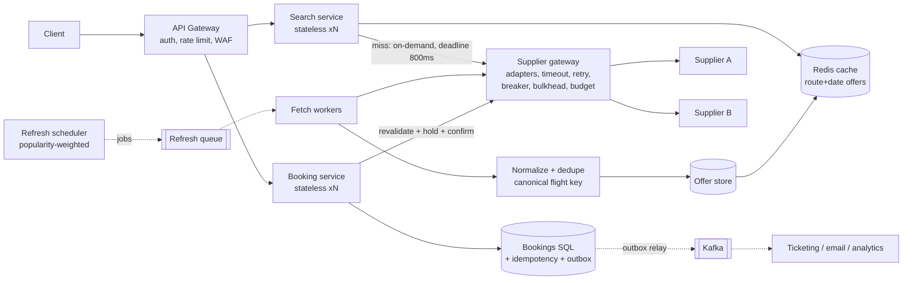
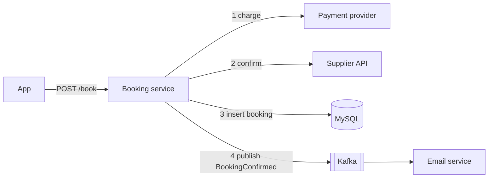
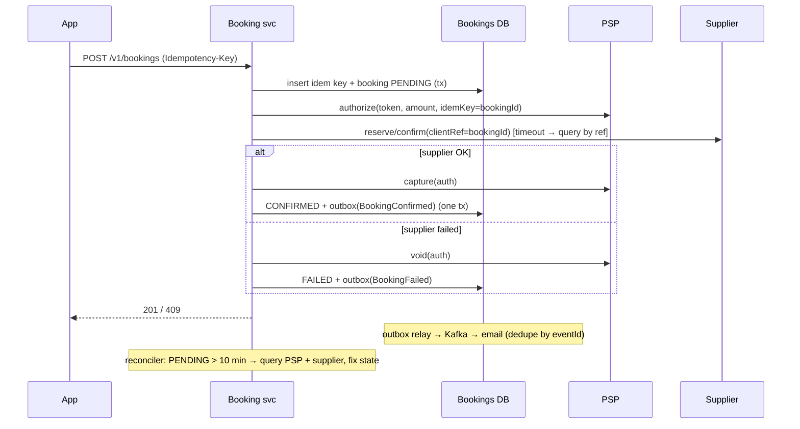
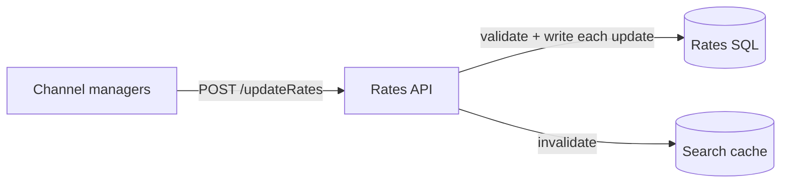
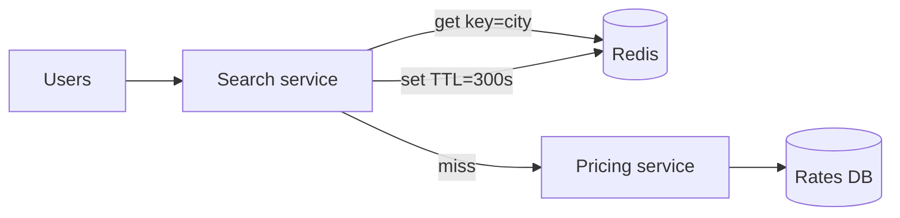

# Practice Scenarios: 6 narratives in Agoda's format

Each scenario mimics the real round: **a prompt + a deliberately flawed diagram + a thin API or code snippet**. Practise **out loud with a timer**, following [01-Narrative-Playbook](01-Narrative-Playbook.md): clarify (4 min) → gap list (5 min) → redesign (10 min) → API + connectivity (8 min) → test plan (4 min).
Write your answer first. Then open the folded key and score yourself on the 5 attributes ([07-Mocks rubric](07-Mocks.md#rubric)).

| # | Scenario | Evidence it's likely | Main skills |
|---|---|---|---|
| **S1** ★★★ | Flight aggregator over metered supplier APIs | Asked in **Bangkok Staff May 2026** and **Gurugram SSE Oct 2025** | Pull strategy, cache, cost, dedupe, pagination, booking |
| **S2** ★★★ | Hotel booking with supplier confirmation + payment | Booking code review in 3 reports | Idempotency, double booking, saga, outbox |
| **S3** ★★ | Partner rate/availability push (channel manager → Agoda) | Agoda's real ARI connectivity | Inbound API, auth, ordering, backpressure |
| **S4** ★★ | Nightly content sync from a rate-limited supplier | "External supplier fetching data" (Staff Sep 2026) | Pagination, rate limits, checkpointing, deltas |
| **S5** ★★ | Search results caching for a hot city | "Search API needs to be cached" | Cache design, stampede, invalidation, freshness |
| **S6** ★ | Booking-event notifications to partners | Webhooks/pub-sub in the recruiter tips | Webhooks, pub/sub, retries, DLQ, ordering |

---

## S1 ★★★ Flight aggregator over metered supplier APIs

**Prompt (as the interviewer would give it):**
> We aggregate flights from several suppliers. Each supplier exposes a search API and a booking API. **Every API call costs money.** Suppliers don't push updates. Prices and seat availability change often. Users search by origin, destination and date, and should see the latest data. The same flight can come from several suppliers: show the cheapest. Here's the current design and API. What would you improve?


```
GET  /searchFlights?from=BKK&to=SIN&date=2026-12-01      → 200 [ ...all flights... ]
POST /bookFlight   { flightNo, date, price, userId, card }  → 200 "OK"
```

<details><summary>Expected gap list (aim for 12+ before opening)</summary>

1. **Every search fans out synchronously to every supplier**: latency = slowest supplier; cost = searches × suppliers (metered!); a supplier outage breaks search.
2. **No cache** for search (the look-to-book ratio is about 1000:1, so most calls are wasted money).
3. **No timeouts, retries, breakers, bulkheads** on supplier calls; **no partial results**.
4. **No dedupe / canonical flight identity** across suppliers; "cheapest" logic undefined (currency, fees, baggage).
5. **Single instance of the service**, no LB, a single DB → SPOFs; search and booking share one service (different scaling and SLOs).
6. **No pagination** on `/searchFlights`: it returns everything.
7. **API design**: verbs in paths, no versioning, no auth, no error model; `POST /bookFlight` takes the **price from the client** (tamperable) and a **raw card** (PCI scope); returns `"OK"` with no booking ID.
8. **No idempotency** on booking → double booking/charge on retry.
9. **No re-validation of price/availability at booking** (search data may be stale).
10. **No double-booking protection** (seat inventory is the supplier's; we need hold → confirm).
11. **No async processing** (ticketing, emails, supplier confirmation can be slow).
12. **No rate limiting** inbound (bots scraping prices drive *our* supplier costs up) or outbound (supplier limits).
13. **No observability** (per-supplier latency, error and cost metrics).
14. **Secrets/auth to suppliers** unspecified.
</details>

<details><summary>Improved design</summary>



**Key decisions (say mechanism + trade-off for each):**
- **Split search (read-heavy, eventually consistent) from booking (write, strongly consistent).** They scale and fail independently.
- **Pull model with tiered freshness:** popular routes refreshed every few minutes by workers; the long tail fetched on demand on a cache miss with **single-flight**; TTL by tier. Trade-off: freshness vs supplier spend. Measure it with "price changed at booking %" and cost per 1,000 searches.
- **Look vs book:** search can be slightly stale; booking **re-validates** price/seat live with the chosen supplier → if changed, return `409 price-changed` with the new price.
- **Supplier gateway** = one adapter per supplier (Strategy) + shared resilience (timeouts, retry with backoff + jitter on idempotent search calls only, breaker, bulkhead, token-bucket budget). Partial results with per-source status.
- **Dedupe:** canonical key `carrier+flightNo+date+cabin`; keep all offers, show the cheapest after normalising currency + fees; tie-break on supplier reliability.
- **Batch/delta endpoints** if suppliers have them (fewer calls); conditional requests (ETag).
- **Booking flow:** `Idempotency-Key` → create PENDING → supplier **hold/reserve** (with our ref as their client reference) → payment (PSP token, its own idempotency key) → supplier **confirm/ticket** → CONFIRMED + outbox event. Compensate on failure (release the hold, refund). A reconciliation job for unknown states.
- **Inbound rate limiting / bot protection** at the gateway: scraping drives supplier spend.

**API:**
```
GET  /v1/flights/search?from=BKK&to=SIN&date=2026-12-01&pax=1&cabin=Y&limit=50&cursor=…
     200 { offers:[{offerId, flightKey, price:{amount:"123.40",currency:"USD"}, supplier, expiresAt}],
           partial:false, sources:{A:"ok",B:"timeout"}, nextCursor }
POST /v1/bookings   Idempotency-Key, Authorization: Bearer
     { offerId, passengers[], paymentToken } → 201 {bookingId,status} | 202 pending | 409 price-changed / sold-out
GET  /v1/bookings/{id}
```
</details>

<details><summary>Test plan + metrics</summary>

- Unit: dedupe/cheapest (same flight, 3 suppliers, currencies, ties), TTL tier selection, backoff maths.
- Component: stub suppliers with latency/500/429 → partial results within the deadline, no retry storm, breaker opens.
- Integration: idempotency (same key twice → one booking), outbox exactly-once delivery to consumers (dedupe).
- Contract: recorded supplier fixtures + a nightly sandbox schema check.
- Load: search at 2× peak against cache, with the supplier call rate staying under budget. Chaos: kill supplier B → search still OK with `partial`.
- Prod: per-supplier RED + **spend/quota dashboards**, cache hit ratio, price-changed-at-booking rate, booking success rate SLO, canary per supplier adapter release.
</details>

<details><summary>Likely follow-ups</summary>

- "Suppliers start offering webhooks: what changes?" → push updates the offer store; keep polling at a lower rate as reconciliation; verify signatures, handle ordering.
- "One supplier is 10× slower than the others?" → its own bulkhead + shorter deadline; show its results progressively or skip it.
- "How do you pick refresh frequency?" → search logs → demand per route/date; cost model; an experiment on TTLs.
- "How do you know you're wasting money?" → calls per booking per supplier; cache hit ratio; the % of refreshed routes never searched.
</details>

---

## S2 ★★★ Hotel booking with supplier confirmation + payment

**Prompt:**
> Users book hotel rooms. The room belongs to an external supplier. We charge the customer's card, then confirm with the supplier. Recently customers got **charged twice**, and some got **confirmation emails for bookings the supplier never received**. Here's the design and the core code.


```java
public BookingResponse book(BookingRequest r) {
    paymentClient.charge(r.getCard(), r.getAmount());
    String ref = supplierClient.confirm(r.getHotelId(), r.getRoomId(), r.getDates());
    bookingRepo.save(new Booking(r, ref));
    kafka.send("booking-confirmed", r.getBookingId());
    return new BookingResponse("CONFIRMED");
}
```

<details><summary>Expected gaps</summary>

1. **Double charge**: the mobile client retries on timeout; no idempotency key → charged again. Also no PSP idempotency key.
2. **Charge before availability is secured**: we charge, then the supplier says sold out → refund flow (bad UX, fees). → Authorise (hold funds) → supplier confirm → capture.
3. **Dual write / no compensation**: `save` and `kafka.send` aren't atomic. A crash between them gives a saved booking that's never emailed. A crash (or exception) after `charge` + `confirm` but before `save` gives money taken and the supplier booked, with **no record on our side**. And if `confirm` throws after the charge, nothing refunds. The "emails for bookings the supplier never received" symptom points to a confirm that timed out *ambiguously* or a code path that publishes on partial success.
4. **The ambiguous supplier timeout**: did the confirm go through? Retrying may double-book at the supplier; not retrying may lose the booking. → Our booking ref as the supplier's client reference; on timeout, **query status** before retrying.
5. **No persisted state machine**: a crash mid-flow leaves the money taken and nothing recorded. → PENDING row first.
6. **Concurrency**: two users booking the last room both pass (supplier-side, or our own allotment table).
7. **Raw card through our service** → PCI scope; use PSP tokenisation.
8. **No timeouts / retry policy / breakers** on PSP and supplier.
9. Emails generated from an event that doesn't carry the data → the consumer has to call back; the consumer isn't idempotent (duplicate emails).
</details>

<details><summary>Improved design: orchestrated saga + outbox</summary>


- States: `PENDING → AUTHORIZED → SUPPLIER_CONFIRMED → CAPTURED/CONFIRMED`, or `FAILED` with compensations; every transition is idempotent and persisted.
- If the saga is long, return `202` + a status endpoint; push to the app when done.
- Daily **reconciliation** against PSP settlement files and supplier booking reports catches the leftovers.
- Staff add-on: **orchestration over choreography** for money flows (one place to see state, easier audits); a booking state-machine library reusable across products (flights, hotels, activities).
</details>

<details><summary>Test plan</summary>

- Same idempotency key ×2 concurrently → one booking, one authorisation.
- PSP authorise OK, supplier times out → status query path; supplier confirms late → no double booking.
- Kill the service after authorise, before supplier → the reconciler voids or completes.
- Outbox relay killed mid-batch → each event delivered at least once; the email consumer dedupes → exactly one email.
- Contract tests with PSP and supplier sandboxes; chaos on supplier latency; a load test on the booking path at peak flash-sale RPS.
</details>

---

## S3 ★★ Partner rate/availability push (channel manager → Agoda)

**Prompt:**
> Hotels update rates and availability through channel managers, which call our API. Peak: 20k updates/s during morning batch runs. Lately, prices on the site are sometimes **older than what the hotel sent**, and during peaks the API **times out** and partners complain.


```
POST /updateRates  Basic auth (one shared account)  body: [ ...up to 10,000 updates... ]
→ 200 after all rows written
```

<details><summary>Expected gaps + fixes</summary>

- **Synchronous write of 10k rows per request** → timeouts → partners retry → more load (a retry storm). → **Accept-and-queue**: validate the envelope, persist to a durable log (Kafka), return `202 Accepted` + a batch ID, process async; a status endpoint/webhook for per-item errors.
- **Ordering**: parallel processing applies an older update after a newer one → **partition by `hotelId+roomType`** (per-key ordering) and/or compare **sequence numbers/timestamps from the partner** (last-writer-wins by source version, not arrival).
- **Shared Basic auth account** → per-partner credentials (OAuth2 client-credentials or HMAC-signed requests, mTLS for big partners), scopes limited to *their* hotels (**authZ: can partner X update hotel Y?**).
- **No rate limiting / backpressure** → per-partner quotas, 429 + `Retry-After`; batch size cap (e.g. 1,000).
- **No idempotency** → a batch ID/idempotency key; per-item version makes reapplying harmless.
- **Write amplification on cache** (invalidate per row) → coalesce invalidations per hotel in a short window.
- **Validation**: dates in range, currency valid, price sanity bounds (a price of 0 or 100× yesterday → quarantine + alert the partner).
- Observability: per-partner ingest rate, lag (update received → visible on site: the key SLO, e.g. p99 < 60 s), rejection rate.
- API: `POST /v1/ari/batches` (202) · `GET /v1/ari/batches/{id}` · versioned schema; protobuf/gRPC option for high-volume partners.
- Tests: an ordering property test (shuffled updates → final state = the highest version), load at 2× peak, a partner contract suite published as a public conformance kit (Staff touch: **certification sandbox for partners**).
</details>

---

## S4 ★★ Nightly content sync from a rate-limited supplier

**Prompt:**
> We sync hotel content (descriptions, photos, amenities) for 2M hotels from a supplier every night. The supplier allows **10 requests/s** and returns 100 hotels per page. The job runs on one VM, takes 9 hours, often **fails halfway and restarts from zero**, and sometimes gets **banned for exceeding limits**.

```python
def sync():
    page = 0
    while True:
        r = requests.get(f"{BASE}/hotels?page={page}&size=100", headers={"key": KEY})
        hotels = r.json()["hotels"]
        if not hotels: break
        for h in hotels:
            db.execute(f"INSERT INTO hotels VALUES ('{h['id']}', '{h['name']}', ...)")
        page += 1
```

<details><summary>Expected gaps + fixes</summary>

- **Maths first:** 2M / 100 = 20k pages; at 10 req/s that's ≈ 33 min minimum. 9 h means the time goes elsewhere (row-by-row inserts, no pooling, sequential work).
- **Full sync every night** → ask for a **delta endpoint** (`updatedSince=`) or use ETags/hashes; full sync weekly as reconciliation.
- **Offset pagination on a changing dataset** → skipped/duplicated hotels → cursor pagination if available; otherwise a stable sort + dedupe by ID.
- **No checkpointing** → persist the last completed cursor/page; resume after a crash; make each page idempotent (**upsert**, `INSERT … ON CONFLICT DO UPDATE`).
- **Rate limit violations** → a client-side token bucket at ~8 req/s (headroom), honour 429/`Retry-After`, backoff with jitter. Parallel workers share **one** distributed limiter.
- **No timeouts, status checks, retries**; **SQL injection** via supplier data (yes, supplier data is untrusted input too); row-by-row inserts → batch upserts in a transaction per page.
- **Single VM** → a job orchestrator (k8s CronJob/Airflow) with retries; or split into a producer (page cursors) + a queue + workers.
- Photos: don't download synchronously in the sync; enqueue → workers → object storage + CDN; dedupe by content hash.
- Data quality: schema validation, quarantine bad records, a diff report ("12k hotels changed, 300 removed": alert if removals > 1%, which guards against a supplier bug wiping content).
- Observability: pages/s, 429 count, progress %, ETA, last successful sync timestamp (alert if > 36 h).
- Tests: stub supplier with pagination + random 429/500 + a crash mid-way → resume test; an upsert idempotency test; a rate-limiter test (never > 10/s over any 1 s window).
</details>

---

## S5 ★★ Search results caching for a hot city

**Prompt:**
> Hotel search for "Bangkok, next weekend" is our hottest query. We added a cache, but during campaigns we see **latency spikes every few minutes** and the **pricing service CPU hits 100%**. Users also sometimes see **prices that differ from the checkout price**.



<details><summary>Expected gaps + fixes</summary>

- **Cache stampede** at TTL expiry (all instances miss at once → pricing CPU spike every 5 min) → single-flight per key + **stale-while-revalidate** (serve stale, one async refresh) + **TTL jitter**; or proactive refresh of hot keys before expiry.
- **Key too coarse** (`city` only) → wrong results across dates/guests/currency/user segment → key = `v1:city:checkin:checkout:guests:currency:segment`; or cache *per-hotel price units* and assemble results (better hit ratio, finer invalidation).
- **Price mismatch** → expected with a cache; make it explicit: checkout **re-prices** authoritatively; show "price updated" UX; reduce the TTL for volatile segments; **event-driven invalidation** when rates change (from the S3 pipeline).
- **Hot key** on one Redis shard → local in-process cache (a few seconds) in front of Redis; key replication.
- Redis down → don't send all traffic to pricing: a breaker + degrade (serve local stale, or shed load).
- Personalised prices (member deals) → don't cache per user; cache the base and apply discounts at read time.
- Metrics: hit ratio per key class, refresh rate, pricing QPS, price-mismatch rate at checkout (business metric).
- Tests: a concurrency test (1,000 concurrent misses → 1 pricing call), a TTL-jitter distribution test, a load test replaying campaign traffic.
</details>

---

## S6 ★ Booking-event notifications to partners

**Prompt:**
> Hotels want to know about bookings, modifications and cancellations within seconds. Today a cron job **polls the bookings table every minute and emails a CSV**. Design the replacement. Some hotels' systems are slow or offline for hours.

<details><summary>Expected answer outline</summary>

- **Options:** webhooks (push, near-real-time, the partner hosts an endpoint), partner polling of a `/v1/events?cursor=` feed (simple for partners, pull-based backpressure), pub/sub or a stream per partner (heavy for small hotels), email (legacy). Offer **webhooks + a pull feed as fallback/reconciliation**.
- **Source of events:** the outbox from the booking service → Kafka `booking-events` (keyed by `bookingId` → per-booking ordering).
- **Delivery service:** per-partner queues/partitions → workers with **per-partner concurrency limits** (a slow partner doesn't block others: bulkhead), retries with exponential backoff up to 24–72 h, a **DLQ** + a partner portal to replay, auto-disable + notify after persistent failure.
- **Payload:** event ID, type, version/sequence, `occurred_at`, a booking snapshot (or thin + fetch). HMAC signature + timestamp. At-least-once: partners must dedupe; document it.
- **Ordering:** a cancellation might arrive before the creation after retries → include a sequence per booking; partners apply only if newer; or deliver serially per booking.
- **Backpressure:** cap the in-flight per partner; if the partner backlog > X, switch them to pull mode.
- **Testing:** a contract/conformance test kit + sandbox for partners; chaos (partner 500s for 2 h → all events delivered in order after recovery); load test at peak booking rate × fan-out.
- **Observability:** delivery latency p99 per partner, failure rate, DLQ size, oldest undelivered event age (SLO: 99% within 30 s).
</details>
