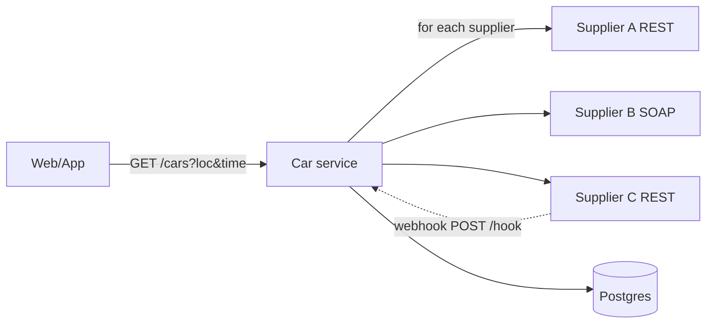
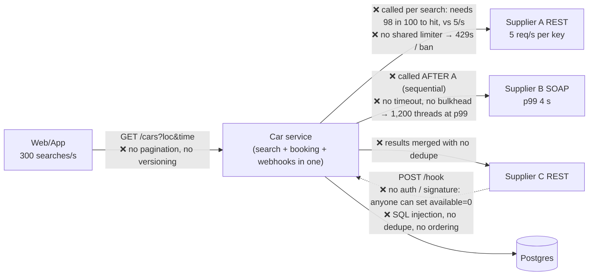
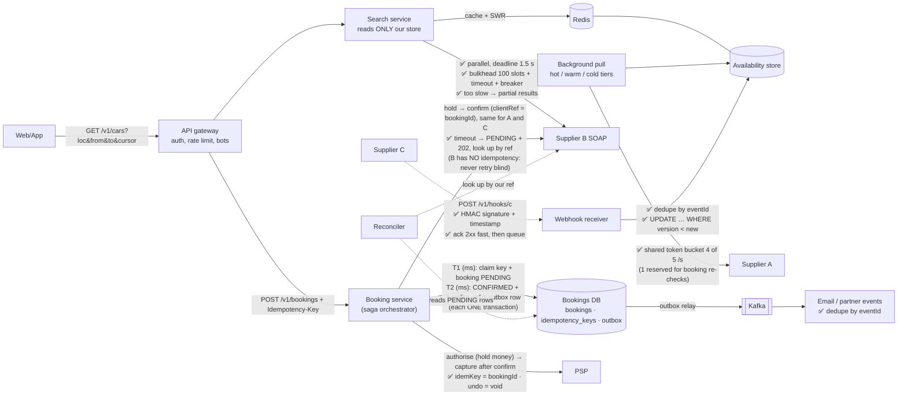
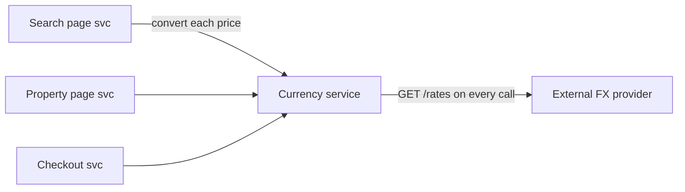
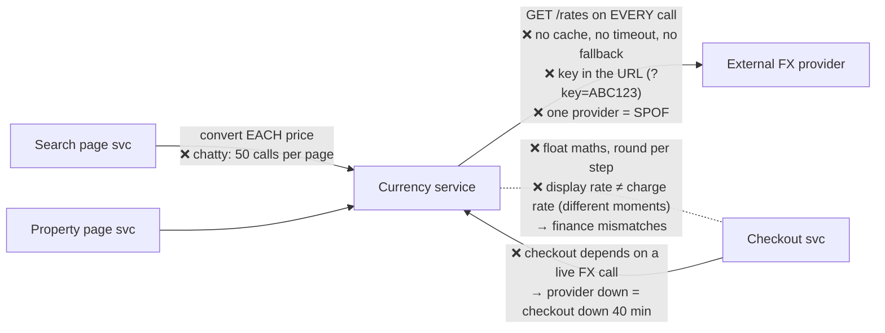
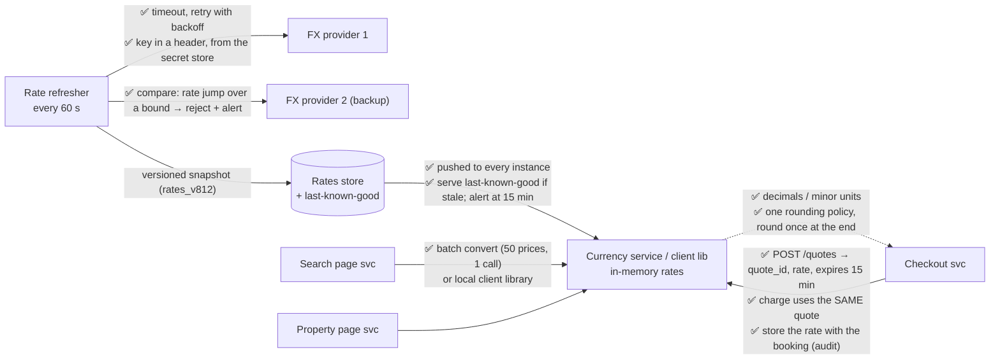
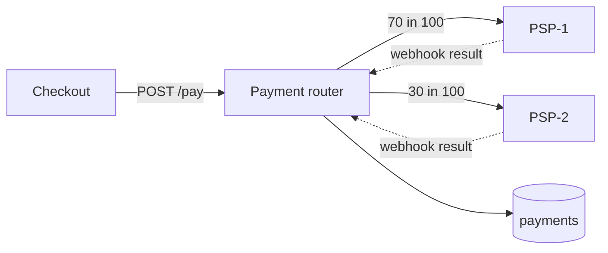
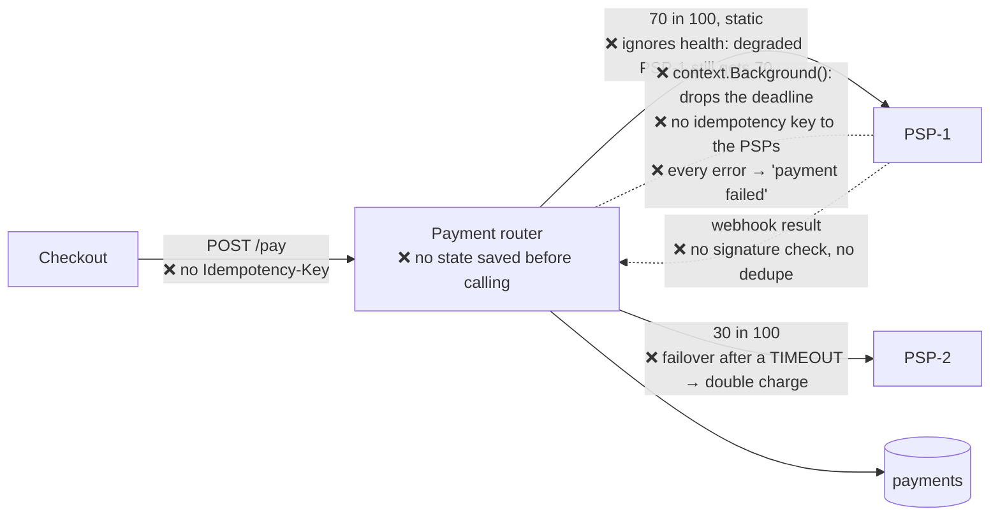
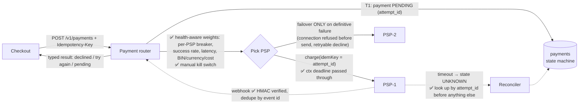

# Mock Rounds: 3 full 60-minute platform interviews

**How to run:** best with the coach (open this folder in Claude Code and say *"Run Mock 1"*; [CLAUDE.md](CLAUDE.md) keeps the interviewer persona and hides the faults). Solo: read only the prompt + diagram + code, set a 60-minute timer, answer aloud (record yourself), then open the interviewer notes and score.
Each mock = **narrative (~40 min, including a code snippet)** + **5 generic questions (~12 min)** + your questions (~3 min).
The narratives are **new** (not S1–S6), so they test transfer, not recall.

---

## Rubric

Score 1–4 per attribute (4 = Strong Hire at Staff level).

| Attribute | 1 | 2 | 3 | 4 (Staff) |
|---|---|---|---|---|
| **System analysis & design** | Fixes random things; misses correctness gaps | Finds obvious gaps; fixes lack trade-offs | Systematic gap list, prioritised; sound fixes with trade-offs | + quantifies (QPS, cost), names failure modes and how to detect them, rollout/migration plan |
| **Connectivity** | Names patterns without mechanics | Knows retries/timeouts but misses idempotency/limits/partial results | Correct protocol choice, error model, auth, retries, idempotency, pagination | + supplier economics (cost/quota), backpressure, reconciliation, standardised client library |
| **QA** | "Write unit tests" | Lists levels without the why | Maps tests to failure modes; justifies cost vs benefit; covers NFRs | + shift-right (canary, flags, synthetic), contract strategy for externals, quality metrics |
| **Code review** | Style nits; misses security | Finds some real bugs, unprioritised | Catches security/integrity/reliability issues, prioritised, with fixes | + refactor shape (strategy/DI), tone, how to prevent recurrence (lint rules, libraries) |
| **Communication** | Rambling or silent; needs prompting | Understandable but unstructured | Signposted, concise, checks in, adapts to questions | + crisp summaries, handles pushback gracefully, explains to non-technical listeners |

**Pass bar for Staff:** ≥ 3 in every attribute and at least two 4s. Log scores in [PROGRESS.md](PROGRESS.md).

---

## Mock 1: Car-rental availability aggregator

**Narrative prompt:**
> We're adding car rentals. We integrate 3 rental suppliers. Users search by pickup location and time; we show cars from all suppliers, then book. Supplier A has a REST API with 5 req/s per API key. Supplier B uses SOAP and is slow (p99 4 s). Supplier C offers webhooks for availability changes. Here's our first version.


**Code snippet (shown at ~minute 25):**
```java
@PostMapping("/hook")
public void hook(@RequestBody String body) {
    JsonNode n = new ObjectMapper().readTree(body);
    jdbc.update("UPDATE cars SET available=" + n.get("available") + " WHERE id='" + n.get("carId").asText() + "'");
}

@GetMapping("/cars")
public List<Car> cars(String loc, String time) {
    List<Car> all = new ArrayList<>();
    all.addAll(supplierA.search(loc, time));
    all.addAll(supplierB.search(loc, time));
    all.addAll(supplierC.search(loc, time));
    return all;
}
```
**Generic questions:** (1) REST vs gRPC for internal pricing calls? (2) How do you test a circuit breaker? (3) JWT vs sessions? (4) What do you block a PR for? (5) Explain backpressure to a PM.

<details><summary>Interviewer notes (open after the mock)</summary>

Expected: sequential fan-out → parallel with a deadline + partial results; **B is slow** → its own bulkhead + timeout, or async/progressive results, plus a cache; **A's 5 req/s limit** → a shared token bucket across instances (one key = global limit), caching, maybe more keys by contract; **C webhooks** → verify the signature, timestamp, dedupe, ordering (version), ack fast + queue, a reconciliation poll; the webhook code has **SQL injection**, no auth/signature, an `ObjectMapper` per call, no validation (null `available`), no error handling, synchronous DB write (fine if fast, but enqueue at scale); `/cars` has no pagination, no dedupe, no timeouts, sequential calls, verbs are fine but no versioning; car availability for a *time range* (a model issue); booking: hold → confirm with the supplier, idempotency. Tests: Toxiproxy on B, limiter test for A, webhook replay/order tests, contract fixtures for SOAP.
</details>

<details><summary>Improved design: before (faults on the arrows) → after (fixes on the arrows)</summary>

**Ask first:** searches/s (say 300 at peak)? Look-to-book (100:1 → about 3 bookings/s)? How many API keys for A? Does each supplier support an idempotency key or a lookup by our reference? Are C's webhooks signed, and can they repeat or arrive out of order?

#### The numbers (do them aloud, right after clarifying; method in [02c](02c-Numbers-Load-Backpressure.md))
```
A's limit vs search:  5 /s ÷ 300 /s = 1 in 60 may miss → 98% hit needed
                      → unrealistic for location + time → A comes OFF the search path
A's daily budget:     5 /s × 10⁵ s = 500k calls/day → hot keys + misses + booking re-checks
Slow B (Little):      300 /s × 4 s (p99) = 1,200 threads stuck → bulkhead of 100 slots
                      100 ÷ 1.2 s ≈ 80 /s served; the rest skip B → partial results
Bookings:             300 /s ÷ 100 = 3 bookings/s
```

#### Before


#### After


#### The fixed code (Java sketch)
```java
@PostMapping("/v1/hooks/c")
public ResponseEntity<Void> hook(@RequestHeader("X-Signature") String sig,
                                 @RequestHeader("X-Timestamp") long ts, @RequestBody String body) {
    if (!signer.valid(sig, ts + "." + body) || clock.secondsSince(ts) > 300)    // 1. Leak: HMAC + replay window
        return ResponseEntity.status(401).build();
    queue.publish(body);                                                         // 2. ack fast, process async
    return ResponseEntity.accepted().build();
}
// consumer: one transaction per event
void apply(AvailabilityEvent e) {                                                // mapper injected, schema validated
    if (!processed.insertIfAbsent(e.eventId())) return;                         // 3. dedupe (Do Baar)
    jdbc.update("UPDATE cars SET available = ?, version = ? WHERE id = ? AND version < ?",
                e.available(), e.version(), e.carId(), e.version());             // 4. params + newer only
}

@GetMapping("/v1/cars")
public Page<Car> cars(@Valid CarQuery q, @RequestParam(required = false) String cursor) {
    Deadline d = Deadline.after(Duration.ofMillis(1500));                        // 5. one deadline for all
    List<CompletableFuture<Result>> calls = sources.stream()                     //    (A and C read from our store)
        .map(s -> s.searchAsync(q, d).exceptionally(Result::failed)).toList();  // 6. parallel; failure → partial
    List<Car> cars = dedupe(join(calls, d));                                     // 7. one car per canonical key
    return Page.of(sortByPrice(cars), cursor, 50);                               // 8. capped page + cursor
}
```

#### Test map
| Failure | Level | Assert |
|---|---|---|
| We exceed A's 5/s | unit (fake clock) | never > 5 calls in any 1-s window, across instances |
| C sends the same event twice / v6 then v5 | integration, real DB | one change; v6 stays |
| Forged or replayed webhook | integration | 401; the row is unchanged |
| B slow under load | load + fault injection (proxy adds 4 s) | threads bounded by the bulkhead; searches return partial results within 1.5 s |
| B's SOAP format changes | contract fixtures + nightly sandbox | our parser still maps B's real replies |
| Booking times out at B | integration | PENDING + 202; the reconciler finds it by our ref; no second booking |

🔑 *Pehle hisaab: 5 ÷ 300 = 98% hit? Toh A search se bahar.* (Maths first: 5 ÷ 300 = 98% hits? Then A is off the search path.)
</details>

---

## Mock 2: Multi-currency price display service

**Narrative prompt:**
> Every price on Agoda is shown in the user's currency. A Currency service fetches exchange rates from an external FX provider and converts prices for the search, property and checkout pages. During last month's provider outage, **checkout was down for 40 minutes**, and finance reports **small mismatches** between charged and displayed amounts.


**Code snippet:**
```python
class CurrencyService:
    def convert(self, amount: float, frm: str, to: str) -> float:
        rates = requests.get(f"https://fx.example.com/latest?key=ABC123&base={frm}").json()["rates"]
        return round(amount * rates[to], 2)
```
**Generic questions:** (1) Design a retry policy. (2) Offset vs cursor pagination. (3) How do you test a DB migration? (4) Contract testing: what and why? (5) How would you drive adoption of a shared library across teams?

<details><summary>Interviewer notes</summary>

Expected: **an external call per conversion** (every search result price!) → a rates cache refreshed on a schedule (every minute), served from memory, **last-known-good** fallback with a staleness limit + alert → the outage no longer takes down checkout. Chatty API → a batch convert API, or ship rates to callers (a client library with a local cache). **Mismatches**: float maths and rounding at different steps/places; display rates vs charge rates differ in time → use decimals/minor units, a single rounding policy (banker's?), **lock the rate at checkout** (a quote with an ID + expiry, used at charge time), store the rate used with the booking (audit). Second FX provider for redundancy, compared to detect bad data (a sanity bound on rate jumps). Code: hardcoded key in the URL, no timeout, no status check, a new connection per call, a KeyError on an unknown currency, float. Tests: property-based rounding tests, provider-down chaos test (checkout still works on cached rates), rate-quote expiry tests, reconciliation report charged vs displayed.
</details>

<details><summary>Improved design: before (faults on the arrows) → after (fixes on the arrows)</summary>

**Ask first:** conversions/s (a search page shows ~50 prices; say 3,000 searches/s)? FX provider limits and cost? How fresh must rates be (display vs charge)? Do we charge in the user's currency or ours?

#### The numbers
```
Calls to FX today: 3,000 searches/s × 50 prices = 150,000 provider calls/s   ← one per conversion
Rates actually change: ~160 currencies, refreshed every 60 s = 1 call per minute
→ the provider belongs OFF the request path; conversions become in-memory maths (microseconds)
```

#### Before


#### After

**Metrics:** rate age (alert if > 15 min), charged vs displayed mismatch count, provider error rate.

#### The fixed code (Python sketch)
```python
class CurrencyService:
    def __init__(self, rates_cache):                         # 1. injected; refreshed in the background
        self.rates = rates_cache
    def convert(self, amount: Decimal, frm: str, to: str, quote_id=None) -> Decimal:
        snap = self.rates.quote(quote_id) if quote_id else self.rates.current()   # 2. checkout: locked quote
        if frm not in snap or to not in snap: raise UnknownCurrency(frm, to)      # 3. no KeyError
        if snap.age() > MAX_STALE: metrics.stale_rates.inc()                       # 4. last-known-good, but visible
        value = amount * snap[to] / snap[frm]                                      # 5. Decimal, no float
        return value.quantize(Decimal("0.01"), rounding=ROUND_HALF_EVEN)          # 6. round ONCE, one policy
```

🔑 *Rate har minute lao, har call pe nahi; checkout pe rate taala lagao.* (Fetch rates every minute, not on every call; lock the rate at checkout.)
</details>

---

## Mock 3: Payment routing across multiple PSPs

**Narrative prompt:**
> We charge customers through two payment providers (PSP-1 and PSP-2) to get better acceptance rates and redundancy. The routing service picks a PSP per transaction. Customers report **double charges after "payment failed" messages**, and when PSP-1 degraded last week, **all traffic still went to it**.


**Code snippet:**
```go
func (r *Router) Pay(ctx context.Context, req PayReq) (string, error) {
    psp := r.p1
    if rand.Intn(100) >= 70 { psp = r.p2 }
    res, err := psp.Charge(context.Background(), req.CardToken, req.Amount)
    if err != nil {
        other := r.p2
        if psp == r.p2 { other = r.p1 }
        res, err = other.Charge(context.Background(), req.CardToken, req.Amount)
    }
    if err != nil { return "", errors.New("payment failed") }
    return res.ID, nil
}
```
**Generic questions:** (1) How does a circuit breaker work? (2) Saga: orchestration vs choreography? (3) What non-functional tests before a campaign? (4) Code review on a senior's PR who disagrees? (5) Strong vs eventual consistency with travel examples.

<details><summary>Interviewer notes</summary>

Expected: **failover after an ambiguous error = double charge**. A timeout from PSP-1 doesn't mean it failed; retrying on PSP-2 charges twice → only fail over on *definitive* failures (connection refused before send, explicit declines that are retryable elsewhere); on timeouts, **query PSP-1 by idempotency key/reference** first. **No idempotency keys** to the PSPs (each supports them) → use the payment attempt ID. `context.Background()` drops the request deadline/cancellation → pass `ctx`, with per-call timeouts. **Static 70/30 routing** → health-aware routing: per-PSP breaker, success-rate/latency-based weights, BIN/currency/cost-based rules, manual kill switch. A payment state machine persisted *before* calling (PENDING → AUTHORIZED/FAILED/UNKNOWN), webhook results reconcile states (verify signatures, dedupe, ordering), a reconciler for UNKNOWN, daily settlement reconciliation. The error message loses detail (decline vs technical) → typed errors for UX ("card declined" vs "try again"). Tests: timeout-then-success on PSP-1 must not charge PSP-2; webhook-before-response race; breaker opens on degradation and traffic shifts; load at peak; PSP sandbox contract tests. Metrics: auth rate per PSP, latency, unknown-state count, double-charge detector.
</details>

<details><summary>Improved design: before (faults on the arrows) → after (fixes on the arrows)</summary>

**Ask first:** payments/s at peak? Does each PSP accept an idempotency key and a lookup by our reference? Which errors are definitive declines vs technical? Cost and acceptance rate per PSP?

#### The double charge, step by step
```
Router → PSP-1: charge ₹12,000 ─────► PSP-1 charges the card ✔
          ✂ timeout (reply lost)
Router: err != nil → fail over
Router → PSP-2: charge ₹12,000 ─────► PSP-2 charges AGAIN ✔   ← two charges
Router → user: "payment failed"   (both actually succeeded)
```
A timeout means **unknown**, not failed. Never fail over on unknown.

#### Before


#### After

**Metrics:** acceptance rate per PSP, latency, UNKNOWN count, a double-charge detector (two successful charges for one checkout).

#### The fixed code (Go sketch)
```go
func (r *Router) Pay(ctx context.Context, req PayReq) (Result, error) {
    att, dup := r.repo.ClaimPending(ctx, req.IdemKey, req)          // 1. idempotent; duplicate → stored result
    if dup { return att.Result, nil }
    for _, psp := range r.selector.Rank(req) {                      // 2. health-aware order, breakers skip bad PSPs
        res, err := psp.Charge(ctx, req.Token, req.Amount, att.ID)  // 3. ctx kept; idempotency key = attempt id
        switch {
        case err == nil:            return r.repo.Succeed(ctx, att.ID, psp, res)
        case IsDefinitive(err):     r.repo.NoteFailure(ctx, att.ID, psp, err); continue  // 4. safe to try the next PSP
        default:                    r.repo.MarkUnknown(ctx, att.ID, psp)                 // 5. timeout: NEVER fail over
                                    return Result{Status: "PENDING"}, nil                //    reconciler looks it up
        }
    }
    return r.repo.Fail(ctx, att.ID, ErrDeclined)                    // 6. typed error for the UI
}
```

🔑 *Timeout = pata nahi, fail nahi. Pehle poocho, phir doosra PSP.* (A timeout means unknown, not failed. Ask first, then the other PSP.)
</details>
