# Cohort exercises — Weeks 01–08 (complete catalog)

Single reference for every exercise in the Feb 2025 system-design cohort notes under `cohort/week-XX-*/exercises.md`. Use this to implement on your own (with other models or solo). **No implementation code here** — only concepts, gotchas, verification, stretch goals, and prototype pointers where they exist.

**How each entry is shaped**

| Field | Purpose |
|---|---|
| **Type** | `prototype` (runnable in `prototypes/`), `guidance` (notebook / SQL / ops / UI), or `paper` (design / vendor docs) |
| **Concept** | What you build or do |
| **What you learn** | Mental-model payoff — why the exercise exists |
| **Gotchas** | Failure modes most people miss |
| **Verify** | What to measure or observe |
| **Stretch** | Next experiment |
| **Prototype** | Folder under `Go/Learn/prototypes/` when applicable |

**Totals:** Week 1 (9) · Week 2 (9) · Week 3 (12) · Week 4 (15) · Week 5 (9) · Week 6 (7) · Week 7 (9) · Week 8 (6) → **76 exercises**

```mermaid
flowchart LR
  subgraph w1 [Week 1]
    pools[Pools and routing]
    realtime[Realtime spectrum]
    brokers[Brokers]
  end
  subgraph w2 [Week 2]
    db[DB concurrency and sharding]
    nosql[Graph doc PubSub]
  end
  subgraph w3 [Week 3]
    ids[Distributed IDs]
    ops[DB ops at scale]
  end
  subgraph w4 [Week 4]
    cache[CDN cache hot keys]
    redis[Redis HA]
  end
  subgraph w5 [Week 5]
    ch[Consistent hash]
    storage[Bitcask and IO]
  end
  subgraph w6 [Week 6]
    lsm[LSM Bloom streaming]
  end
  subgraph w7 [Week 7]
    search[Search scheduler brokers]
  end
  subgraph w8 [Week 8]
    geo[Geo pagination probabilistic]
  end
  w1 --> w2 --> w3 --> w4 --> w5 --> w6 --> w7 --> w8
```

**Suggested build order (highest payoff per week)** — from the week files:

| Week | Priority exercises |
|---|---|
| 1 | 1 bounded pool, 2 sharding router, 9 realtime chat |
| 2 | 1 airline check-in, 3–4 KV then shard, 6 2PC |
| 3 | 1 atomic counter, 2 Snowflake, 8 UUID vs bigint bench |
| 4 | 1 toy CDN, 2 hashtag counter, 3 denormalization |
| 5 | 1–3 consistent hashing, 8 Bitcask, 9 seq vs random IO |
| 6 | 2 Bloom FPR, 6 1 GB streaming upload, 1 LSM (large) |
| 7 | 8 brokers ×3, 6 scheduler, 3 contact search |
| 8 | 1 GeoHash, 2 cursor pagination, 3 EVAL vs EVAL_RO |

---

## Week 01 — System design foundations

**Theme:** Primitives under pools, routing, replication, fairness, and the realtime delivery spectrum (polling → SSE → WebSocket → brokers).

---

### 1. Connection pool from a bounded blocking queue

- **Type:** prototype  
- **Concept:** Fixed reusable resources (e.g. DB connections) in a bounded queue: acquire blocks when empty, release blocks when full. In Go, a buffered channel is this structure.  
- **What you learn:** The same data structure powers connection pools, worker pools, and rate-limited pipelines — ~90% of broker/pool internals.  
- **Gotchas:** Leak on panic (always `defer release()`); acquire timeout vs blocking forever; pool size vs DB `max_connections`; validate or expire idle connections.  
- **Verify:** Throughput and p99 acquire latency at pool sizes 1, 10, 100 with more callers than slots; force exhaustion → timeout path; omit one `release()` → starvation.  
- **Stretch:** Per-caller FIFO fairness on acquire (ties to exercise 4).  
- **Prototype:** `bounded-blocking-pool/`, also `connection-pooling/`, `thread-pool/`

---

### 2. DB sharding and routing from the API server

- **Type:** prototype  
- **Concept:** API owns routing: `shard = hash(key) % N` or range/directory; writes to owner; multi-key reads scatter-gather and merge.  
- **What you learn:** Routing reappears in sharded KV, distributed IDs, consistent hashing, hot shards — shard **key** choice is as important as a primary index.  
- **Gotchas:** `% N` remaps almost everything on topology change (use consistent hashing); hot shard on skewed keys; no cross-shard SQL joins/ACID; scatter-gather p99 = slowest shard.  
- **Verify:** 100K keys across N=4 — distribution; point lookup vs range scan latency; change N and count remaps under `% N` vs CH.  
- **Stretch:** Directory (per-tenant) routing vs hash routing.  
- **Prototype:** `db-sharding-router/`

---

### 3. MySQL read-replica locally

- **Type:** prototype  
- **Concept:** Primary → replica via binlog; writes primary, reads replica; measure lag.  
- **What you learn:** Cheapest read scale-out; replica lag breaks read-your-own-writes (fixed properly in Week 2 and Week 7).  
- **Gotchas:** Stale reads after write; async vs semi-sync; read/write split routing; replication stall — monitor `Seconds_Behind_Master`.  
- **Verify:** Write primary, immediate read replica → stale; lag under write burst; primary kill mid-write → what replica has.  
- **Stretch:** Write-LSN token — read replica only when caught up past binlog position.  
- **Prototype:** `mysql-read-replica/` (Docker)

---

### 4. Fair multi-threaded program

- **Type:** prototype  
- **Concept:** Compare unfair `sync.Mutex` vs FIFO ticket lock under contention.  
- **What you learn:** Noisy-neighbour pathology in pools, limiters, brokers; fairness shows up in p99, not averages.  
- **Gotchas:** Fairness costs throughput (cache locality); measure per-thread p99; livelock vs deadlock on naive backoff.  
- **Verify:** N threads on shared counter — per-thread completion counts and p99; mutex starves one thread, ticket lock does not.  
- **Stretch:** Weighted fairness (premium 3× share).  
- **Prototype:** `fair-multithreaded/`

---

### 5. Server-Sent Events (SSE)

- **Type:** prototype  
- **Concept:** One-way HTTP stream: `text/event-stream`, `data:` frames, reconnect with `Last-Event-ID`.  
- **What you learn:** Default for server push when you do not need client→server on the same channel — avoids WebSocket capacity/sticky tax.  
- **Gotchas:** Must flush after each event; no client channel on SSE alone; HTTP/1.1 connection limits per origin; honor `Last-Event-ID` on reconnect.  
- **Verify:** Kill server, restart — client reconnects with last ID without gaps/dupes; events not batch-buffered.  
- **Stretch:** Per-user event history for replay after downtime.  
- **Prototype:** `sse-server/`

---

### 6. Short polling vs long polling (mock EC2 creation)

- **Type:** prototype  
- **Concept:** Job not ready: short poll every T seconds vs long poll held until ready or timeout.  
- **What you learn:** Baseline for comparing push transports — client waste vs server-held connections.  
- **Gotchas:** Short poll latency ≈ interval, load ∝ 1/interval; long poll holds slots/goroutines; LB/proxy idle timeouts; thundering herd on same event — coalesce/broadcast.  
- **Verify:** Job done at t=5s — compare result latency and request count at 1K waiters.  
- **Stretch:** Conditional short poll with ETag / `If-None-Match`.  
- **Prototype:** `polling-short-long/`

---

### 7. RabbitMQ producer/consumer locally

- **Type:** prototype  
- **Concept:** Exchange → queue → consumer ack; redelivery; prefetch.  
- **What you learn:** Queue semantics: work distribution, at-least-once, DLQ vocabulary for all async systems.  
- **Gotchas:** Idempotent consumers; prefetch=1 fair vs high prefetch hoarding; ack after process not on receipt; poison → DLQ after N tries.  
- **Verify:** Two consumers one slow — prefetch 1 vs high; kill consumer before ack → redelivery; failure loop → DLQ.  
- **Stretch:** DLQ + retry with backoff under 10% failures.  
- **Prototype:** `rabbitmq-demo/` (Docker)

---

### 8. Kafka producer/consumer locally

- **Type:** prototype  
- **Concept:** Partitioned append-only log; consumer groups; offsets; retention not delete-on-read.  
- **What you learn:** Log vs queue mental model — replay, ordering per partition, rebalance.  
- **Gotchas:** Ordering per partition only; partition count caps parallelism and is semi-permanent; offset commit before vs after process; rebalance pauses consumption.  
- **Verify:** 3 partitions — 1, 3, then 4 consumers (4th idle); kill consumer → rebalance; replay from offset 0.  
- **Stretch:** Idempotent consumer keyed by `(partition, offset)`.  
- **Prototype:** `kafka-demo/` (Docker)

---

### 9. Real-time chat over WebSockets (hub / rooms)

- **Type:** prototype  
- **Concept:** Persistent sockets, rooms, fan-out, heartbeats, history via REST.  
- **What you learn:** Full operational shape of push: presence, fan-out, WebSocket cost model, multi-server gap.  
- **Gotchas:** Cross-server fan-out needs Redis PubSub or sticky routing; backpressure on slow clients; reconnect + missed messages; presence via heartbeat TTL not raw connect.  
- **Verify:** Broadcast latency vs room size; slow client → bounded buffer not OOM; reconnect no gaps; two instances → cross-server gap.  
- **Stretch:** Redis PubSub between two server instances.  
- **Prototype:** `realtime-chat/`

---

## Week 02 — Databases

**Theme:** Concurrency control, KV on MySQL and sharding, RYW, 2PC, graph/document models, cross-server PubSub.

---

### 1. Airline check-in (seat allocation)

- **Type:** prototype  
- **Concept:** Race for seats: pessimistic `SELECT … FOR UPDATE` vs optimistic versioned `UPDATE … WHERE version`.  
- **What you learn:** Canonical read-modify-write under contention; when each strategy wins.  
- **Gotchas:** Naive check-then-act double-books; pessimistic queues on hot rows; optimistic retry storms on last seat; lock scope on non-indexed predicates.  
- **Verify:** 100 concurrent on 10 seats — no lock vs pessimistic vs optimistic; 1000 on 1 seat — optimistic degrades.  
- **Stretch:** Hold seat 5 min TTL (soft lock) and crash mid-hold.  
- **Prototype:** `airline-checkin/`

---

### 2. Induce DB deadlock (circular dependency)

- **Type:** prototype  
- **Concept:** Two transactions lock rows A,B in opposite order → InnoDB deadlock victim.  
- **What you learn:** Deadlocks are normal — global lock ordering + retry on 1213.  
- **Gotchas:** Must retry victim; lock order across all code paths; deadlock ≠ lock-wait timeout; gap-lock deadlocks in RR.  
- **Verify:** Two goroutines (A→B) vs (B→A); `SHOW ENGINE INNODB STATUS` deadlock section; fixed order → no deadlock.  
- **Stretch:** Gap-lock deadlock with concurrent inserts.  
- **Prototype:** `db-deadlock-demo/`

---

### 3. Toy KV store on MySQL

- **Type:** prototype  
- **Concept:** `get/put/delete` on table `kv(key PK, value BLOB, …)`.  
- **What you learn:** Why purpose-built KVs exist — SQL/parser/planner/txn overhead.  
- **Gotchas:** Every get pays SQL stack; key type VARCHAR vs BINARY; large BLOB off-page; TTL needs column + sweeper.  
- **Verify:** QPS/p99 vs in-memory map and Redis; 1M keys size; TTL sweeper cost.  
- **Stretch:** Append-only log + compaction preview of Week 5/6.  
- **Prototype:** `kv-store-mysql/`, `key-value-store/`

---

### 4. Shard the KV store (hash / range)

- **Type:** prototype  
- **Concept:** Router in front of N KV instances; hash or range ownership.  
- **What you learn:** Horizontal scale price: no free cross-shard ops, rebalancing pain.  
- **Gotchas:** `% N` vs consistent hashing; hot shard; MGET scatter-gather; multi-key atomicity needs 2PC or co-location.  
- **Verify:** 1M keys balance; N 4→5 remap count; single-key vs all-shard scan time.  
- **Stretch:** Shard move dual-write + backfill + cutover.  
- **Prototype:** `kv-store-sharded/`

---

### 5. Flag-driven consistent reads (read-your-own-writes)

- **Type:** prototype  
- **Concept:** After write, flag or window forces read from primary despite replica routing.  
- **What you learn:** Cheapest RYW fix; routing knob vs read scale.  
- **Gotchas:** Not global primary reads; window must cover p99 lag; write-LSN more precise; cache invalidation alternative.  
- **Verify:** Write then immediate read — stale on replica, fresh with flag; primary load vs window size.  
- **Stretch:** End-to-end write-LSN on replica when caught up.  
- **Prototype:** `consistent-reads-flag/` (needs replica setup)

---

### 6. Distributed transactions via 2PC

- **Type:** prototype  
- **Concept:** Coordinator prepare → commit/abort across participants.  
- **What you learn:** Cross-shard atomicity and blocking failure mode → sagas.  
- **Gotchas:** Coordinator crash blocks prepared participants; not a substitute for idempotency; heuristic decisions break atomicity; ≥2 RTTs per txn.  
- **Verify:** Latency vs single-node; crash at each phase boundary; locks during prepared window.  
- **Stretch:** Same flow as saga with compensations — when each fits.  
- **Prototype:** `distributed-2pc/`

---

### 7. Neo4j ingest and paginate

- **Type:** prototype  
- **Concept:** Load users/follows graph; Cypher traversals; cursor pagination.  
- **What you learn:** Graph for relationship-heavy queries; traversal and pagination costs.  
- **Gotchas:** Depth explosion on hubs; SKIP/OFFSET O(skipped); supernodes; index lookup keys.  
- **Verify:** 1/2/3-hop normal vs supernode; SKIP vs cursor at depth; stability under concurrent inserts.  
- **Stretch:** “Who to follow” 2-hop ranked by mutuals.  
- **Prototype:** `neo4j-pagination/` (Docker Neo4j)

---

### 8. MongoDB ingest and aggregation pipeline

- **Type:** prototype  
- **Concept:** Documents + pipeline `$match → $group → $sort → $lookup` with indexes.  
- **What you learn:** Document model + stage order like reading a SQL plan.  
- **Gotchas:** Early `match`/`sort`; expensive `lookup`;COLLSCANwithoutindexes;`skip` at depth; 16 MB doc / pipeline memory limits.  
- **Verify:** `explain` with/without indexes; stage reorder; embedded vs `$lookup` for same data.  
- **Stretch:** Same data embedded vs normalized — benchmark dominant query.  
- **Prototype:** `mongo-aggregation/` (Docker MongoDB)

---

### 9. Cross-server broadcast — Redis PubSub star

- **Type:** prototype  
- **Concept:** N app servers PUBLISH/SUBSCRIBE via Redis for room/global broadcast.  
- **What you learn:** Fixes Week 1 multi-server chat gap; central hub vs partition tolerance.  
- **Gotchas:** PubSub fire-and-forget no replay; hub SPOF; per-room channels vs global amplification; ordering per publisher only.  
- **Verify:** 3 servers message from A reaches B,C; kill Redis → silent loss; per-room vs global volume.  
- **Stretch:** Redis Streams with consumer groups for catch-up.  
- **Prototype:** `redis-pubsub-star/`, `pub-sub/`

---

## Week 03 — Distributed systems (IDs, pagination, ops)

**Theme:** Distributed ID schemes, B+ tree / PK choices, pagination, sharding operations, 2PC refresher.

---

### 1. Atomic on-disk counter (persist-every-N + recovery)

- **Type:** prototype  
- **Concept:** In-memory counter; persist every N or Δt; on startup advance by safety margin before serving.  
- **What you learn:** Foundation under Snowflake, offsets, autoincrement — durability vs throughput.  
- **Gotchas:** Crash between bump and persist → duplicates without margin; `Write` ≠ disk without `Sync()`; 64-bit alignment on 32-bit.  
- **Verify:** IDs/sec at persist intervals 1, 100, 10000; kill mid-stream → monotonicity and wasted IDs.  
- **Stretch:** Raft-replicated counter vs fsync.  
- **Prototype:** `id-atomic-counter/`

---

### 2. Snowflake on API server

- **Type:** prototype  
- **Concept:** 64-bit ID: time | machine-id | per-ms sequence; local generation.  
- **What you learn:** Industry-standard distributed ID layout and variants.  
- **Gotchas:** Clock step-back — wait or refuse; sequence overflow per ms; unique machine-id assignment; custom epoch; rough time sort not global strict order.  
- **Verify:** IDs/sec; inject backward clock; two instances same ms distinct.  
- **Stretch:** HTTP `/parse?id=` decomposes ID.  
- **Prototype:** `id-snowflake-api/`

---

### 3. MongoDB ObjectID structure

- **Type:** guidance (research)  
- **Concept:** 12-byte layout: unix seconds | random process | counter.  
- **What you learn:** Simpler cousin to Snowflake; design space comparison.  
- **Gotchas:** Second granularity ordering; random process vs machine-id; no clock-skew refusal; per-process counter on restart.  
- **Verify:** Parser; 1M loop uniqueness; two processes concurrent uniqueness.  
- **Stretch:** Sort stability vs Snowflake in index page splits.

---

### 4. Flickr odd/even ID generation (two MySQL)

- **Type:** guidance  
- **Concept:** Two DBs with `auto_increment_increment=2` and offsets 1 and 2 → interleaved IDs.  
- **What you learn:** Partition namespace not requests — coordination-free for fixed N.  
- **Gotchas:** Third instance painful; write skew on global order; both DBs must survive; no clock dependency.  
- **Verify:** Two containers round-robin inserts; restart preserves offset.  
- **Stretch:** Migrate increment 2→3 without downtime.

---

### 5. Snowflake-style ID in stored procedure

- **Type:** guidance  
- **Concept:** Same algorithm inside DB — clients call `SELECT next_id()`.  
- **What you learn:** Deployment trade-off: app vs DB vs Redis EVAL for ID path.  
- **Gotchas:** Proc deploy/version pain; counter row contention; failover and durable counter; single DB bottleneck.  
- **Verify:** Throughput and p99 vs app Snowflake; failover behavior.  
- **Stretch:** Redis Lua script comparison.

---

### 6. Central ID service (“Amazon’s way”)

- **Type:** guidance  
- **Concept:** Dedicated ticket server; leader + followers; CP ID issuance.  
- **What you learn:** CAP corner for IDs — consistency vs partition behavior.  
- **Gotchas:** Leader throughput ceiling; failover gap; partitions block followers; client batching trick.  
- **Verify:** Batch size 1 vs 100 vs 1000; kill leader — failover time and in-flight IDs.  
- **Stretch:** Raft CP vs independent AP issuers.

---

### 7. Sharded blogging app with unique blog IDs

- **Type:** guidance  
- **Concept:** Per-shard AUTO_INCREMENT collides globally — offsets, Snowflake, or `(shard_id, local_id)`.  
- **What you learn:** Why distributed IDs exist as a discipline.  
- **Gotchas:** Fixed shard offsets; Snowflake decoupled from shard; composite FK invasion; resharding; cross-shard joins impossible in SQL.  
- **Verify:** N=3 shards 100K blogs unique; add 4th shard per scheme behavior.  
- **Stretch:** App-level cross-shard join users ↔ blogs.

---

### 8. UUID vs bigint primary key benchmark

- **Type:** prototype  
- **Concept:** BIGINT AUTO_INC vs BINARY(16) UUIDv4 (and v7) — 1M inserts.  
- **What you learn:** Percona claim on random PK page splits — visceral numbers.  
- **Gotchas:** v4 random vs v7 time-prefixed; CHAR(36) vs BINARY(16); secondary indexes carry PK; cold cache > buffer pool.  
- **Verify:** Write throughput, p99 insert, tablespace/index bytes, query on secondary.  
- **Stretch:** UUIDv7; rearranged bytes in BINARY(16).  
- **Prototype:** `bench-uuid-vs-bigint/` (Docker MySQL)

---

### 9. MySQL upsert benchmark — ON DUPLICATE KEY UPDATE vs REPLACE INTO

- **Type:** guidance  
- **Concept:** Insert-or-update under contention; FK and trigger behavior differs.  
- **What you learn:** Staff-level SQL taste for upserts.  
- **Gotchas:** REPLACE = delete+insert (FK, triggers, AI gaps); ODKU in-place; Postgres `ON CONFLICT` parallel.  
- **Verify:** Throughput at 50% conflict rate; InnoDB locks; AI values after runs.  
- **Stretch:** FK + BEFORE DELETE trigger — REPLACE doubles work.

---

### 10. Pagination benchmark — LIMIT/OFFSET vs cursor

- **Type:** guidance  
- **Concept:** Deep page: `OFFSET 10M` vs `WHERE id > last LIMIT n`.  
- **What you learn:** Universal scaling foot-gun for feeds and APIs.  
- **Gotchas:** OFFSET O(offset); cursor needs total order `(created_at, id)`; total count separate; stable sort under inserts.  
- **Verify:** Latency at offset 1, 1K, 100K, 1M; EXPLAIN filesort vs index.  
- **Stretch:** Descending keyset tuple comparison.

---

### 11. Logical shards on physical servers — dump, move, ALTER pain

- **Type:** guidance (ops)  
- **Concept:** 8 logical shards on 2 hosts; add 3rd; `mysqldump` move; ALTER all shards.  
- **What you learn:** Operational shape of DB scaling (Notion-style).  
- **Gotchas:** Dump blocking; shared buffer pool on co-located shards; online ALTER duration at TB scale; schema drift across shards — gh-ost/pt-osc.  
- **Verify:** Dump+restore wall time 1/10/100 GB; ALTER vs row count; pool exhaustion under traffic.  
- **Stretch:** Zero-downtime move via dump + replication catch-up + cutover.

---

### 12. Distributed transactions / 2PC (refresher)

- **Type:** prototype  
- **Concept:** Same as Week 2 #6 — prepare/commit failure modes.  
- **What you learn:** Cross-shard writes and exactly-once pipelines substrate.  
- **Gotchas:** Blocking on coordinator death; heuristic violations; idempotency still required; sagas in microservices.  
- **Verify:** Latency overhead; failures per phase; blocking states.  
- **Stretch:** Saga with compensating actions.  
- **Prototype:** `distributed-2pc/`

---

## Week 04 — Build social networks (cache, hot keys, Redis HA)

**Theme:** CDN, counters, denormalization, auth, realtime+Kafka, Redis cluster/replication/sentinel, indexes, uploads, cache headers.

---

### 1. Toy CDN (origin pull, TTL, conditional GET, invalidation)

- **Type:** prototype  
- **Concept:** Reverse-proxy cache: miss → origin; hit within TTL; revalidate with validators.  
- **What you learn:** Loop behind every CDN and `proxy_cache`.  
- **Gotchas:** Cache key + `Vary`; TTL 0 vs no-store vs no-cache; stale-while-revalidate.  
- **Verify:** Hit ratio; origin vs client request multiplier; cached vs uncached latency; 304 on conditional GET.  
- **Stretch:** Stale-while-revalidate; single-flight on miss storm.  
- **Prototype:** `toy-cdn/`

---

### 2. Hashtag counter — five approaches

- **Type:** prototype  
- **Concept:** Global per-tag counts at scale — compare five write paths:

| # | Approach | DB writes per N events | Trade-off |
|---|---|---|---|
| 1 | Naïve per-event UPDATE | N | Lock contention |
| 2 | Batched queue flush every K | N/K | Crash loses batch |
| 3 | In-memory map + STW deep-copy flush | ~1/tag/interval | STW pause |
| 4 | Two-map swap | ~1/tag/interval | Merge both maps |
| 5 | Kafka partition by tag + per-partition counter | ~1/tag/partition/flush | Infra + horizontal |

- **What you learn:** Canonical hot-key write problem (likes, views, +1).  
- **Gotchas:** Crash drift on 2–4; map races — swap pattern; tag normalization; top-K vs long-tail.  
- **Verify:** Events vs DB writes; p99 ingest under spike; drift on lossy approaches.  
- **Stretch:** HyperLogLog for distinct users per tag.  
- **Prototype:** `hashtag-counter/`

---

### 3. Denormalization impact — MongoDB embedded array growth

- **Type:** prototype  
- **Concept:** `user.blogs[]` embedded; measure read latency and size 10 → 10,000 blogs.  
- **What you learn:** When denormalization breaks (16 MB limit, rewrite amplification).  
- **Gotchas:** 16 MB doc cap; `push`rewrite;fullarrayloadwithout`slice`; cannot shard by `blog_id`.  
- **Verify:** Read latency vs array length; disk size vs normalized; writes per blog added.  
- **Stretch:** Bucketed collections (100 blogs per bucket doc).  
- **Prototype:** `denormalization-impact/` (Docker MongoDB)

---

### 4. CDN signup + first config (Cloudflare free tier)

- **Type:** guidance  
- **Concept:** NS to Cloudflare; orange-cloud proxy; page rules.  
- **What you learn:** Hands-on edge caching mental model.  
- **Gotchas:** DNS propagation wait; orange vs gray cloud; exposed origin IP; free tier limits.  
- **Verify:** Second curl `cf-cache-status: HIT`; TTFB before/after.  
- **Stretch:** Cloudflare Worker custom header.

---

### 5. CDN failover (80/20 origins)

- **Type:** guidance  
- **Concept:** Primary 80% / warm secondary 20%; health fail → 100% secondary.  
- **What you learn:** Origin shielding and AZ outage behavior.  
- **Gotchas:** Random vs sticky split; warm secondary needs traffic; deep health checks not just `/health`.  
- **Verify:** Failover detection time = threshold × interval.  
- **Stretch:** Session affinity through failover.

---

### 6. JWT-based auth

- **Type:** guidance  
- **Concept:** Sign on login; verify per request without DB hit.  
- **What you learn:** Dominant API auth pattern and failure modes.  
- **Gotchas:** Algorithm confusion — pin alg; localStorage vs httpOnly cookies; revocation via short TTL + refresh or `jti` blocklist; clock skew on exp.  
- **Verify:** Tampered claim rejected; expired rejected; refresh works.  
- **Stretch:** RS256 — public key on API tier only.

---

### 7. OG image generation

- **Type:** guidance  
- **Concept:** Dynamic 1200×630 PNG for link previews.  
- **What you learn:** Async generation, cache keys, headless render cost.  
- **Gotchas:** Sync on request path kills SLO; cache key all parameters; font load slow in Chrome; scraper UA needs real image.  
- **Verify:** Cold vs cached latency; hit ratio on viral share.  
- **Stretch:** Pure Go SVG/PNG pipeline without Chrome.

---

### 8. Lazy-load images on static page

- **Type:** guidance  
- **Concept:** Defer image fetch until near viewport.  
- **What you learn:** Fastest request is one you skip; LCP vs lazy conflict.  
- **Gotchas:** Native `loading="lazy"`; reserve aspect ratio against CLS; never lazy the LCP image.  
- **Verify:** Network count before scroll; Lighthouse LCP.  
- **Stretch:** BlurHash placeholder.

---

### 9. WebSocket + Kafka for message delivery

- **Type:** guidance  
- **Concept:** Chat message → Kafka → gateway consumers → user’s socket.  
- **What you learn:** Slack/Discord split: ephemeral connections vs durable bus.  
- **Gotchas:** user → gateway mapping; at-least-once dedupe at client; reconnect jitter; FD limits and ping/pong.  
- **Verify:** Connections per gateway; e2e latency; recovery after gateway kill.  
- **Stretch:** Presence in Redis with TTL heartbeat.  
- **Related:** `realtime-chat/` then swap in-memory bus for Kafka.

---

### 10. Redis cluster (3 masters, 3 replicas)

- **Type:** guidance  
- **Concept:** Local 6-node cluster; MOVED/ASK; reshard.  
- **What you learn:** Hash slots and hash tags in production Redis Cluster.  
- **Gotchas:** Dev `bind`/`protected-mode`; `cluster-config-file` managed by Redis; `{}` hash tags for multi-key; reshard redirects.  
- **Verify:** `CLUSTER SLOTS`; `KEYSLOT`; `FAILOVER`.  
- **Stretch:** Kill master — time to promote.

---

### 11. Redis replication (master + 2 replicas)

- **Type:** guidance  
- **Concept:** `REPLICAOF`; full and partial resync.  
- **What you learn:** Offset/backlog under Sentinel and Cluster.  
- **Gotchas:** Replica read-only; `min-replicas-to-write`; backlog size vs disconnect duration.  
- **Verify:** `INFO replication` offsets; brief disconnect → partial resync.  
- **Stretch:** Lag under load; `WAIT` behavior.

---

### 12. Redis Sentinel (3 sentinels, quorum failover)

- **Type:** guidance  
- **Concept:** Monitor master+replica; ODOWN; promote; client asks sentinels for master.  
- **What you learn:** Mid-scale Redis HA vocabulary.  
- **Gotchas:** Odd sentinel count; quorum vs leader election; client sentinel addrs; `down-after-milliseconds` latency stack.  
- **Verify:** Time kill -9 master → new master; client reconnect.  
- **Stretch:** Partition one sentinel — no false failover.

---

### 13. Unread message indicator (composite index)

- **Type:** guidance  
- **Concept:** `COUNT(*) WHERE recipient_id=? AND read_at IS NULL`.  
- **What you learn:** Composite index design for bread-and-butter queries.  
- **Gotchas:** `(recipient_id)` alone wrong; `(recipient_id, read_at)`; partial index on unread (Postgres); denormalized `unread_count` at scale.  
- **Verify:** EXPLAIN rows examined with/without index.  
- **Stretch:** Sharded by user_id — index still helps per shard.

---

### 14. Pre-signed S3 URL for direct upload

- **Type:** guidance  
- **Concept:** Backend presigns PUT; browser uploads to S3; backend records key.  
- **What you learn:** Standard large-upload pattern — no bytes through app servers.  
- **Gotchas:** Bucket CORS; Content-Type in signature; least-privilege IAM; multipart >100 MB.  
- **Verify:** Presign <50ms; upload works; expired URL fails.  
- **Stretch:** S3 event → `/upload/complete` without client callback.

---

### 15. Static site with perfect caching headers

- **Type:** guidance  
- **Concept:** Fingerprinted assets immutable long TTL; HTML short TTL + revalidate.  
- **What you learn:** Split between always-revalidate shell and never-invalidate assets.  
- **Gotchas:** Long HTML TTL traps users on old asset URLs; prefer ETag; `Vary: Accept-Encoding`.  
- **Verify:** curl -I headers; Lighthouse caching; WebPageTest waterfall.  
- **Stretch:** Service worker offline-first.  
- **Related:** use `toy-cdn/` as origin.

---

## Week 05 — Build KV / Redis (hashing, storage engine)

**Theme:** Consistent hashing + vnodes, mini-Redis, CSV vs Bitcask, torn writes, checksums, compaction, sequential IO.

---

### 1. Implement consistent hashing

- **Type:** prototype (combined CH)  
- **Concept:** Ring maps key → node; add/remove moves ~K/N keys.  
- **What you learn:** DHT, CDN POP selection, Redis Cluster slot logic — not `% N`.  
- **Gotchas:** Fixed-width hash space + binary search; wrap past last node; hash quality (xxHash/Murmur).  
- **Verify:** 1M keys / 10 nodes stddev with 1 token/node; add 11th node — ~1/11 keys move.  
- **Stretch:** Primary + replica successors on ring.

---

### 2. Consistent hashing as load balancer

- **Type:** prototype (combined CH)  
- **Concept:** Ring picks backend by `client_id` / session / path.  
- **What you learn:** Stickiness without `ip % N` thrash on topology change.  
- **Gotchas:** Key choice trade-offs; vnodes mandatory for balance; bounded-load CH exists.  
- **Verify:** Per-backend load vs RR; 100% stickiness stable topology; ~10% reroute on one backend death with vnodes.  
- **Stretch:** Health checks exclude unhealthy ring positions.

---

### 3. Virtual nodes for skew

- **Type:** prototype (combined CH)  
- **Concept:** ~150 positions per physical node on ring.  
- **What you learn:** Production CH always uses vnodes — skew 25% → ~5%.  
- **Gotchas:** `hash(node_id:i)` not sequential i; 100–200 sweet spot; kill node spreads load across survivors.  
- **Verify:** Skew vs vnodes ∈ {1,10,50,100,200,500}; routing table memory; recovery spread.  
- **Stretch:** Weighted vnodes for bigger machines.

---

### 4. In-memory single-node cache like Redis

- **Type:** guidance  
- **Concept:** TCP + subset RESP: SET/GET/DEL/EXPIRE/INCR/LPUSH/LPOP.  
- **What you learn:** Redis as composable TCP + map + parser.  
- **Gotchas:** RESP framing not line-split; lazy + sweep TTL; single-threaded vs global lock; protocol errors close conn.  
- **Verify:** redis-benchmark vs real Redis; p99; bytes/key overhead ~80.  
- **Stretch:** RESP3; MULTI/EXEC; AOF.

---

### 5. Word dictionary — CSV vs Bitcask

- **Type:** guidance  
- **Concept:** Lookup word → definition: sorted CSV+binary search vs Bitcask append + keydir.  
- **What you learn:** RUM trade-offs on real workload.

| | CSV | Bitcask |
|---|---|---|
| Read | O(log N) seeks | Hash + one seek |
| Update | Rewrite whole file | Append + keydir |
| Memory | Minimal index | All keys in RAM |

- **Gotchas:** CSV rewrite absurdity is the lesson; Bitcask keydir ~50 B/key; Put needs fsync for durability.  
- **Verify:** Load 100K; read p50/p99; single update latency; RAM idle.  
- **Stretch:** Third implementation with bbolt B+ tree.

---

### 6. Partial data write problem

- **Type:** guidance  
- **Concept:** Kill -9 mid 100 MB file write — inspect torn state.  
- **What you learn:** WAL recovery muscle memory.  
- **Gotchas:** Record format length+CRC+payload; SIGKILL not SIGTERM; torn length vs payload; scan-truncate recovery.  
- **Verify:** 20 kills — categorize outcomes; recovery scan speed on 100 MB.  
- **Stretch:** Simulated power loss torn 4 KB pages.

---

### 7. Checksum-based corruption detection + recovery

- **Type:** guidance  
- **Concept:** CRC32 per record; scan and truncate at first bad record.  
- **What you learn:** Silent corruption vs loud failure.  
- **Gotchas:** `[crc][len][payload]` endianness; IEEE CRC32; truncate WAL vs refuse data file.  
- **Verify:** Flip random bit → detect; 1 GB WAL recovery time.  
- **Stretch:** xxHash64 throughput comparison.

---

### 8. Bitcask — KV + merge and compaction

- **Type:** prototype  
- **Concept:** Append-only files, keydir, tombstones, background merge, hint files, fsync policy.  
- **What you learn:** Full storage engine lineage to LSM/RocksDB.  
- **Gotchas:** Active file rotation; hints for fast recovery; merge races with active file; crash-safe merge via temp+rename; RWMutex + single writer.  
- **Verify:** Write/read throughput table (fsync per write vs batched); read p50/p99; merge MB/s; recovery time 10 GB with hints.  
- **Stretch:** Range scans need BTree keydir; TTL in merge; WAL replication to follower.

---

### 9. Benchmark sequential vs random I/O

- **Type:** prototype  
- **Concept:** 1 GB write sequential vs random offsets; compare with fsync/O_DIRECT.  
- **What you learn:** 10–100× gap that drives LSM and group commit.  
- **Gotchas:** Page cache lies without fsync; block size; SSD vs HDD; read benchmark too.  
- **Verify:** Table sequential vs random 4 KB on your disk; fsync per write vs every N.  
- **Stretch:** O_DIRECT; p99 vs concurrent writers.

---

## Week 06 — High throughput (LSM, Bloom, streaming, GFS)

**Theme:** LSM tree, probabilistic structures, HLS, streaming uploads, GFS design.

---

### 1. Implement an LSM tree (Harvard CS265-scale)

- **Type:** guidance (large prototype)  
- **Concept:** WAL + memtable + L0 SSTables + leveled compaction + Bloom per file + merge iterator + range scans.  
- **What you learn:** RocksDB/LevelDB as “sorted Bitcask with levels”.  
- **Gotchas:** Memtable needs sorted flush; never block writes on flush; L0 overlap; tombstone retention; Bloom sizing; range scan newer-wins merge.  
- **Verify:** Write vs Bitcask; read p50/p99; write amp 10–30; space amp; range scan throughput.  
- **Stretch:** Block cache; snapshots; tiered vs leveled compaction compare.  
- **Effort:** ~600–1000 LOC, ~2 weekends.

---

### 2. Bloom filter with FPR measurements

- **Type:** prototype  
- **Concept:** m bits, k hashes; measure FPR vs formula.  
- **What you learn:** Why ~10 bits/key ≈ 1% FPR; optimal k is U-shaped.  
- **Gotchas:** uint64 bit store; Kirsch-Mitzenmacher double hashing; good hash not FNV; sweep k not just m.  
- **Verify:** FPR vs m/n; FPR vs k at m/n=10; throughput vs k.  
- **Stretch:** Cuckoo filter; counting Bloom; mmap persisted Bloom.

---

### 3. Deletable Bloom filter

- **Type:** guidance  
- **Concept:** Per-region collision counters — bounded delete with FPR growth.  
- **What you learn:** Price of delete in probabilistic structures.  
- **Gotchas:** Region count r; increment counter on collision during add; clear bit only if counter zero.  
- **Verify:** FPR after adds+deletes vs fresh filter; memory vs plain BF; delete success rate.  
- **Stretch:** vs counting Bloom space.

---

### 4. HLS streaming via Akamai docs (paper)

- **Type:** paper  
- **Concept:** Read Akamai HLS docs — manifests, token auth, segment trade-offs — write-up only.  
- **What you learn:** Production CDN video knobs vs marketing story.  
- **Gotchas:** Token in cache key → 0% hit; per-segment vs manifest signing; token expiry mid-session.  
- **Verify (write-up):** Manifest hierarchy diagram; edge decision sequence; hand-off questions.  
- **Stretch:** Compare Cloudflare/Fastly signing.

---

### 5. HLS streaming server in Go

- **Type:** guidance  
- **Concept:** ffmpeg segments + m3u8 + HTTP serve; optional HMAC URLs.  
- **What you learn:** Video pipeline = ffmpeg + static file semantics.  
- **Gotchas:** MIME types; CORS; Range 206; live vs VOD `#EXT-X-ENDLIST`.  
- **Verify:** TTFF; bandwidth per quality; cache hit behind nginx.  
- **Stretch:** ABR ladder; token auth; LL-HLS.

---

### 6. TCP server accepting 1 GB file (streaming)

- **Type:** prototype  
- **Concept:** Upload 1 GB without buffering whole body in RAM — `io.Copy` discipline.  
- **What you learn:** Backpressure, page cache, atomic rename — same as log shippers and S3 pipelines.  
- **Gotchas:** ReadAll OOM trap; Sync before close; tmp+rename; MaxBytesReader cap; chunked encoding ContentLength -1.  
- **Verify:** Peak RSS naive vs streamed; 100 concurrent uploads; throughput single client.  
- **Stretch:** Hash while streaming; resumable Range upload; pipe to S3 PutObject.

---

### 7. Toy GFS (paper / optional chunkserver)

- **Type:** paper  
- **Concept:** Design master metadata, 64 MB chunks ×3, leases, write pipeline, read path, append semantics, GC, master failover.  
- **What you learn:** Template for Cassandra, Kafka, ES shards — leases and pipelines.  
- **Gotchas:** Master SPOF; stale replica versions; partition handling; at-least-once append duplicates; metadata RAM limit.  
- **Verify (design):** Eight subsystems documented with diagrams.  
- **Stretch:** Map to HDFS/S3; ~300 LOC chunkserver RPCs.

---

## Week 07 — Search, schedulers, brokers

**Theme:** Search IR, ES logging, schedulers with leases, consistent-hash rebalance, three broker flavors, payments webhooks.

---

### 1. Recent search per user

- **Type:** guidance  
- **Concept:** Last N queries per user; `PRIMARY KEY (user_id, query)` + `ON DUPLICATE KEY UPDATE`.  
- **What you learn:** Composite PK upsert pattern reused everywhere (recents, saves, receipts).  
- **Gotchas:** PK column order; cap N; normalize case/trim; VARCHAR index limits utf8mb4; ODKU return codes; index `(user_id, last_searched_at DESC)`.  
- **Verify:** p99 insert/update and top-10 select at 10M rows; storage footprint.  
- **Stretch:** Redis ZSET compare; TTL column + sweeper.

---

### 2. Search logs → Elasticsearch → Kibana

- **Type:** guidance  
- **Concept:** Middleware logs `/search` → bulk to ES → dashboards for latency and zero-result queries.  
- **What you learn:** Closed loop for search quality (synonyms, spell-fix driven by 0-result rate).  
- **Gotchas:** Field allow-list no secrets; bulk flush 1s or 1MB; daily indices + alias; keyword+text on query; async chan never inline ES; cardinality on user_id.  
- **Verify:** Ingest rate; heap <75%; search p99 unchanged with logging on; dashboard panels.  
- **Stretch:** Watcher on 0-result rate; slow-search separate index.

---

### 3. Full-text search on phone contacts

- **Type:** prototype  
- **Concept:** Fuzzy + spell + synonym + phonetic on ~1k contacts; BK tree; re-ranker.  
- **What you learn:** IR triad and “recall wide, rank narrow”.  
- **Gotchas:** Frequency prior for spell; synonym index vs query time; Metaphone English bias; BK insert order; tokenize `"Anu (mom)"`; weight tuning; recall@K vs precision@K.  
- **Verify:** BK lookup ms at 1k/10k/100k; recall@10 on typo and phonetic lists.  
- **Stretch:** Learned re-ranker; trigram substring; 1M synthetic names.

---

### 4. Cache API responses on Akamai (paper)

- **Type:** paper  
- **Concept:** Two-plane TTL, precedence, stale-while-revalidate, surrogate keys, Vary — write-up only.  
- **What you learn:** Production CDN cache key discipline (token stripped from key).  
- **Gotchas:** Query string in key; origin no-store override; `Vary: *`; Cache-Tag opt-in.  
- **Verify (write-up):** Precedence diagram; three power-moves with syntax; hand-off questions.  
- **Stretch:** Cloudflare Cache Rules vs Fastly VCL.

---

### 5. Stream logs → S3 → Athena

- **Type:** guidance  
- **Concept:** Generate logs → gzip PUT partitioned prefix → Athena SQL aggregate.  
- **What you learn:** Log lake cost shape ($/TB scanned) vs ELK.  
- **Gotchas:** Parquet over JSON at scale; date partitions; avoid SELECT *; idempotent keys; small files problem; partition projection vs MSCK.  
- **Verify:** Cost per query; latency vs scanned GB; Parquet vs JSON storage.  
- **Stretch:** Parquet sidecar; Glue crawler; Grafana Athena datasource.

---

### 6. Task scheduler — cron + leasing + fault tolerance

- **Type:** prototype  
- **Concept:** Cron → due jobs; workers `FOR UPDATE SKIP LOCKED`; heartbeat lease; runs table; recovery on worker death.  
- **What you learn:** Integrates locking, leasing, idempotency, alerts — cohort capstone design interview topic.  
- **Gotchas:** `next_fire_at` from previous fire not `now()`; lease > max task duration + heartbeat; UTC storage; backpressure; missed-run policies; idempotent tasks; alert on SLA not single failure.  
- **Verify:** Fire-to-start p50/p99; jobs/sec; recovery ≈ lease after kill worker.  
- **Stretch:** WebSocket job events; Docker runner; DLQ; multi-region.

---

### 7. Team rebalance in scheduler — consistent hashing

- **Type:** guidance (extends #6)  
- **Concept:** Replace `hash(id)%N` with ring + vnodes for schedule ownership.  
- **What you learn:** ~1/N schedules move on worker join/leave vs ~80% under modulo.  
- **Gotchas:** Virtual nodes 100–200; stale membership double-claim — heartbeat + lease; versioned membership row; xxhash not fnv; weighted/bounded-load variants.  
- **Verify:** Fraction moved when 1/5 workers dies ~20%; load skew 1 vs 100 vnodes.  
- **Stretch:** Ring visualization; hot worker detection.

---

### 8. Brokers in three flavours

- **Type:** prototype  
- **Concept:** (1) SQS-style on MySQL: visibility timeout, ack, DLQ. (2) Kafka-style on MySQL: partitions, offsets, replay. (3) SQS-style on Bitcask append log.

- **What you learn:** Whiteboard both broker families and WHEN to pick each.

**SQS-MySQL gotchas:** `SKIP LOCKED`; visibility > processing time; DLQ always; sleep when empty; index `(queue, status, visible_at)`.

**Kafka-MySQL gotchas:** Offsets per consumer group; replay by resetting offset; partition assignment table; ordering per partition only; fixed partition count vs `% N`.

**Bitcask gotchas:** Visibility as latest record per key; rebuild index on replay; compaction drop acked messages.

- **Verify:** Throughput/latency/storage table across three; crash recovery story.

- **Stretch:** 10-min load test chart; inflight UI; CDC fan-out; multi-DC hack.

---

### 9. Razorpay payments + webhooks

- **Type:** guidance  
- **Concept:** Test mode payment link; `/webhook` via ngrok; verify HMAC; dedupe; async process; observe retries.  
- **What you learn:** Four-axis webhook contract in production (sig, idempotency, fast 200, async worker).  
- **Gotchas:** 24h retries → duplicates; verify before DB; `hmac.Equal`; enqueue then 200; raw body for signature; `INSERT IGNORE` on `event_id`; test mode secret.  
- **Verify:** e2e <2s; force 500 ×3 see backoff; duplicate rate over week.  
- **Stretch:** Subscriptions; Slack on bad sig; payment `Idempotency-Key`.

---

## Week 08 — Geo, pagination, probabilistic, sidecars

**Theme:** GeoHash proximity, cursor vs offset, Redis EVAL semantics, PK choice at scale, HLL, fsnotify hot reload.

---

### 1. Find nearby ATMs / drivers — GeoHash from scratch

- **Type:** prototype  
- **Concept:** Encode/decode GeoHash; `GET /near?lat&lon&radius`; Haversine refine; 8 neighbor cells.  
- **What you learn:** Interview-standard geo pattern and boundary miss bug.  
- **Gotchas:** Always 8 neighbors; decode property tests; precision vs radius; Haversine not Euclidean; 180° meridian limit; TTL on moving points.  
- **Verify:** Encode/decode µs; `/near` p99 at 1M points; 100% recall vs Redis GEOSEARCH; boundary miss rate without neighbors.  
- **Stretch:** Hilbert variant; HTML grid visualization; multi-region shards.

---

### 2. Cursor pagination — feed scrolling

- **Type:** prototype  
- **Concept:** Side-by-side OFFSET vs `(created_at, id)` cursor on 1M+ posts; latency vs page depth.  
- **What you learn:** OFFSET cost grows linearly with depth — cursor stays flat.  
- **Gotchas:** Tuple comparison; covering index `(user_id, created_at DESC, id DESC)`; opaque base64 cursor; stale cursor after deletes OK; no free “page 12345”.  
- **Verify:** p99 table depths 1, 10, 100, 1K, 10K — plot lines.  
- **Stretch:** Cached total count; backward pagination; filtered cursor index.

---

### 3. Atomic Redis CAS — EVAL vs EVAL_RO

- **Type:** prototype  
- **Concept:** Rate limiter INCR+EXPIRE in EVAL; leaderboard read in EVAL_RO; 1 master + 2 replicas.  
- **What you learn:** Which node runs script; read offload vs RYW under lag.  
- **Gotchas:** EVAL_RO no writes; go-redis routing; deterministic Lua no `os.time()` inside; EVALSHA NOSCRIPT retry; SLOWLOG for long scripts.  
- **Verify:** Primary/replica CPU split 80/20 read mix; p99 under load; lag bytes from `INFO replication`.  
- **Stretch:** Stale read after write via EVAL_RO; CAS in Lua vs WATCH; Redlock+fencing.

---

### 4. UUID vs auto-increment — insertion cost (10M rows)

- **Type:** guidance  
- **Concept:** Four schemas: BIGINT AI, BINARY(16) v4, VARCHAR(36) v4, BINARY(16) v7 — throughput, size, page splits.  
- **What you learn:** Why UUIDv4 as clustered PK hurts; v7 ≈ sequential.  
- **Gotchas:** BINARY(16) not CHAR(36); InnoDB clustered PK; secondary index bloat; binlog on/off; `innodb_io_capacity`; `Data_free` and `index_page_splits`.  
- **Verify:** Rows/s, table GB, split count, buffer hit rate — four-way table.  
- **Stretch:** Postgres heap table comparison; secondary UUID index.

---

### 5. HyperLogLog — implement and compare Redis

- **Type:** prototype  
- **Concept:** m=2^14 registers, xxhash64, bias correction; 100M uniques; merge = per-register max.  
- **What you learn:** Approx distinct count for metrics pipelines.  
- **Gotchas:** Hash quality; small/large N corrections; sparse representation; merge not sum; 6-bit registers; property-test merge.  
- **Verify:** Memory ~12KB; error bounds at 1k/1M/100M; vs Redis PFCOUNT; merge 1000 splits.  
- **Stretch:** Plug into W7 search logs; sliding window minute sketches; DataSketches compare.

---

### 6. fsnotify config hot-reload sidecar

- **Type:** guidance  
- **Concept:** Watch `app.yaml`; debounce; validate; `atomic.Value` swap; HTTP serves new config <100ms.  
- **What you learn:** Sidecar pattern (nginx, Envoy, feature flags).  
- **Gotchas:** No mutex on readers; debounce editor rename churn; invalid config keeps old; inotify watch limits; recursive watch; symlink ConfigMap pattern; vim tmp files.  
- **Verify:** mv config → first new request <100ms; zero dip RPS; no leak over 1000 reloads.  
- **Stretch:** SIGHUP trigger; /health until first load; NFS polling fallback.

---

## Appendix — cross-week mental models (from week exercise closings)

| Week | Models to carry forward |
|---|---|
| 1 | Bounded queue under every pool; routing layer everywhere; polling→SSE→WS→brokers axis; async ⇒ idempotent consumers; replication lag |
| 2 | RMW needs sync strategy; sharding forbids cheap cross-shard ops; RYW is deliberate; 2PC blocks; pick data model by access pattern |
| 3 | Atomicity at OS/语言/DB/network; ID scheme = CAP choice; sortable IDs cheap in B+ trees; ops dominates at scale |
| 4 | CDN loop; hot-key five approaches; denormalization curves; Redis HA stack |
| 5 | CH + vnodes; Bitcask → LSM lineage; sequential IO wins; torn write + checksum recovery |
| 6 | Bloom/LSM probabilistic vs exact; stream don’t buffer; GFS lease/pipeline template |
| 7 | SKIP LOCKED queues; search IR + ES ops loop; scheduler leases; broker semantics |
| 8 | GeoHash neighbors; cursor not offset; UUIDv7; HLL vs exact; hot reload atomic swap |

---

## Related files

- Per-week detail and cohort pacing: `cohort/week-01-system-design/exercises.md` through `cohort/week-08-geo-probabilistic/exercises.md`
- Runnable implementations: `Go/Learn/prototypes/<name>/`
- Build plan checklist: `cohort/build-plan-checklist.md` (referenced from Weeks 7–8)

*Generated as a consolidated catalog for self-paced implementation — source of truth remains the per-week `exercises.md` files if they diverge.*

